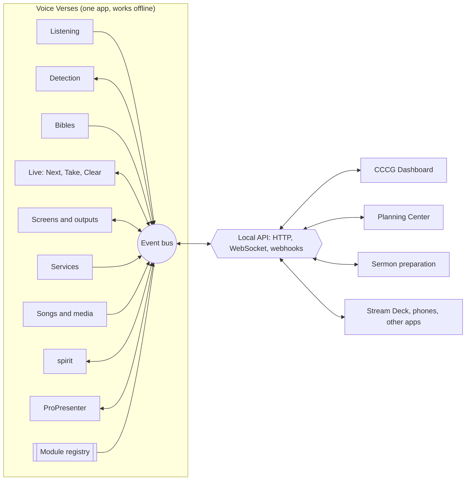

# Voice Verses architecture: modules that advertise and subscribe

Approved by the owner on 17 November 2026 (D33). This is the design every new part of the app follows.

## The idea

Each part of the app is a **module**. A module advertises what it can do and the events it sends, in a **manifest** kept by the **module registry**. Other modules **subscribe** to the events they need through one **event bus**; a publisher never knows who listens. From step 2.2 the same bus is open to other software through the **local API** on the church network. Adding a package (a connector, an importer) means registering one more module; nothing else changes.

It stays **one app, one download, offline** (D27). Separate programs would mean more to install, start and break on older Macs on a Sunday morning. Inside the app the modules are as separate as services; outside, the API makes it behave like one.

## In the code (step 2.1, 1.19.4)

| File | What it is |
| --- | --- |
| `src/core/events.ts` | Every event and what it carries (`EventMap`). Plain values only: no pictures, no keys. |
| `src/core/bus.ts` | `publish(name, data, source)`, `subscribe(pattern, fn, opts)`, `recentEvents()`. Patterns: `*`, `live.*`, or an exact name. |
| `src/core/registry.ts` | `registerModule(manifest)`, `listModules()`, `getModule(id)`. Registering announces `module.registered`. |
| `src/core/modules.ts` | The manifests of the modules the app starts with, and `startModules()` (called once by the operator window in `App.tsx`). |
| `src/modules/` | Modules that act only on events. The first is ProPresenter: it follows `live.changed`, and nothing calls it directly any more. |
| `tools/checks/bus-check.ts` | The bus and registry checks (CI CHECK 10). |
| `tools/e2e/event-bus.cjs` | The bus in the real desktop app. |

### Rules for the bus

- **Envelopes are CloudEvents 1.0.** `type` is `org.voiceverses.<name>.v1`; `source` is `voiceverses://app/<module>`. The local API passes them on unchanged.
- **Versioned names.** A change that would break a subscriber gets a new name (`….v2`) beside the old one, never an edit of it. Adding an optional field is not breaking.
- **Practice never reaches the room** (D31). Events published while practising are marked `practice`, stay in this window, and reach only subscribers that ask for them (`includePractice`). Anything that acts on the room (ProPresenter, connectors, webhooks) must not ask.
- **A subscriber that throws never stops the publisher** or the other subscribers.
- **Other windows** receive events through a `BroadcastChannel` (marked `remote`). A module that acts on the outside world subscribes with `fromOtherWindows: false`, so only the window that published acts.
- **Publish where the thing happens, once.** What the screens show is announced by `syncService.broadcast` itself, so every page that puts something on the screens (the live screen, Presenter, the playlist) is covered without each one remembering.
- **Never put sound, pictures or keys in an event.** `speech.heard` carries finished sentences only.

### Events today

| Event | Sent by | When |
| --- | --- | --- |
| `live.changed` | live (via `syncService`) | A verse, a slide, the logo, or nothing went on the screens |
| `next.changed` | live | What waits in Next changed |
| `countdown.changed`, `alert.changed` | outputs | Countdowns or alerts on the screens changed |
| `listening.started`, `listening.stopped` | listening | Listening started or stopped |
| `speech.heard` | listening | A finished sentence was heard |
| `verse.found` | detection | Detection found a verse; it went to the screens or waits in Next |
| `suggestion.offered` | detection | A verse, song or new singing was offered |
| `service.updated`, `service.deleted` | services | A service or template was saved or deleted (here or by library sync) |
| `media.updated`, `media.deleted` | library | A song, picture or video was saved or deleted |
| `bible.changed` | bibles | The translation on the screens changed |
| `module.registered` | registry | A module started |

## Still to build, in order

1. ✅ **The bus and the registry** (1.19.4). Today's parts announce on the bus; ProPresenter follows it.
2. **The local API v1.** On the server Voice Verses already runs for network screens. Pairing with a six-digit code and scoped keys (`read`, `control`, `write`), `GET /api/v1/modules`, services and packages, `POST /api/v1/live/show|next|take|clear|logo`, events over WebSocket or Server-Sent Events with a filter (`live.*`), signed webhooks, Bonjour/mDNS (`_voiceverses._tcp`), described in OpenAPI and AsyncAPI. Network screens stay read-only and separate.
3. **The service package.** One document per service (order, expected scriptures, songs with credits, announcements, media, notes). Expected scriptures make detection surer and put the first ready in Next; rule 1 stands. Importers: PowerPoint, PDF, Word or text notes, SongSelect.
4. **Connectors.** CCCG Dashboard (their API, or they build to our spec) and Planning Center; the open church feed for any church's own app. Settings → Connections.
5. **Sermon preparation.** Mock-up first; a client of the API, with optional AI from any provider (rule 3).

The design page shown to the owner (with the package and API examples) is published privately; this file is the record in the repository.
