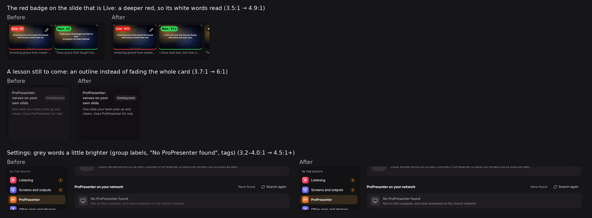

# Every word readable: the measurements

Every piece of text on every screen is measured against the real pixels behind it (WCAG AA: 4.5:1, or 3:1 for text 24px and up, or 18.66px bold, and for a lone symbol) by `tools/e2e/contrast.cjs`, with the foundation's checker (`tools/checks/check-contrast.cjs`). The app has one theme (dark, warm graphite) until light mode ships; add it to the test then.

Run it: `xvfb-run -a node tools/e2e/contrast.cjs` (fails on any text below the mark; `--report` lists each one; `ONLY=<screen>` and `SIZES=1440` to work on one quickly).

## 1.19.19: before and after

Before: **3775 of 4020** pieces of text passed (93.9%). After: **4020 of 4020** (100%), on 56 screens.

What was wrong, and the fix (at the colour, not the element):
- **Settings' quiet grey** (`--s-ink-3` `#78727e`, 3.6:1): group labels, Off, Planned, None yet, tags, the screen tiles' captions. Now `#9d97a3` (the foundation's dark value), 4.5:1 or more on every surface.
- **The app's muted grey** (`--muted-foreground`, 62% lightness): the Space key on Take measured 3.7:1. Now 66%.
- **White words on the red Live badge** (`Live · V1`), 3.45:1. A deeper red of the same hue for badges only (`--live-fill`, 4.9:1); the red frames and dots are unchanged.
- **Words faded with opacity**: dimmed Settings rows (ProPresenter's ways, Devices), moves and cues still to come, the Training card coming soon, the calendar's days from other months, past timeline parts. Now quieter by colour (grey words, a fainter tint), never by fading.
- **Words on pictures of screens** at 40–45% white (Nothing, No logo yet, The next verse or slide waits here): now 70%. On the stage monitor, every line of the header (the slide's title and kind, the book and chapter, "No content selected") and "Waiting for content…" went from 44% of its colour to 70%, and the kind is in plain words (Song, Scripture, Picture; a picture or video coming next is named so, not "Media slide").

What you can see change (2560 wide): 

| Screen | Window | Before | After |
|---|---|---|---|
| live screen, before anything is on | 1440×900 | 80 of 82 (98%) | 82 of 82 (100%) |
| the command palette | 1440×900 | 3 of 3 (100%) | 3 of 3 (100%) |
| live screen, a verse on Live | 1440×900 | 85 of 88 (97%) | 88 of 88 (100%) |
| the library, songs | 1440×900 | 21 of 21 (100%) | 21 of 21 (100%) |
| live screen, a song on Live | 1440×900 | 71 of 73 (97%) | 73 of 73 (100%) |
| Quick edit (a dialog) | 1440×900 | 19 of 19 (100%) | 19 of 19 (100%) |
| live screen, every screen | 1440×900 | 79 of 81 (98%) | 81 of 81 (100%) |
| Services | 1440×900 | 169 of 174 (97%) | 174 of 174 (100%) |
| Media | 1440×900 | 53 of 53 (100%) | 53 of 53 (100%) |
| Looks | 1440×900 | 83 of 83 (100%) | 83 of 83 (100%) |
| Screens | 1440×900 | 98 of 114 (86%) | 114 of 114 (100%) |
| Order of service | 1440×900 | 8 of 8 (100%) | 8 of 8 (100%) |
| Training | 1440×900 | 71 of 81 (88%) | 81 of 81 (100%) |
| a service being planned | 1440×900 | 172 of 172 (100%) | 172 of 172 (100%) |
| Settings → spirit | 1440×900 | 67 of 75 (89%) | 75 of 75 (100%) |
| Settings → moves | 1440×900 | 65 of 76 (86%) | 76 of 76 (100%) |
| Settings → cues | 1440×900 | 63 of 67 (94%) | 67 of 67 (100%) |
| Settings → features | 1440×900 | 78 of 82 (95%) | 82 of 82 (100%) |
| Settings → bible | 1440×900 | 55 of 59 (93%) | 59 of 59 (100%) |
| Settings → songs | 1440×900 | 36 of 40 (90%) | 40 of 40 (100%) |
| Settings → logo | 1440×900 | 36 of 41 (88%) | 41 of 41 (100%) |
| Settings → listening | 1440×900 | 59 of 63 (94%) | 63 of 63 (100%) |
| Settings → screens | 1440×900 | 102 of 121 (84%) | 121 of 121 (100%) |
| Settings → propresenter | 1440×900 | 74 of 80 (92%) | 80 of 80 (100%) |
| Settings → devices | 1440×900 | 35 of 39 (90%) | 39 of 39 (100%) |
| Settings → library | 1440×900 | 41 of 45 (91%) | 45 of 45 (100%) |
| Settings → app | 1440×900 | 46 of 50 (92%) | 50 of 50 (100%) |
| a lesson (the guide and practice) | 1440×900 | 6 of 6 (100%) | 6 of 6 (100%) |
| live screen, before anything is on | 2560×1440 | 72 of 75 (96%) | 75 of 75 (100%) |
| the command palette | 2560×1440 | 3 of 3 (100%) | 3 of 3 (100%) |
| live screen, a verse on Live | 2560×1440 | 113 of 115 (98%) | 115 of 115 (100%) |
| the library, songs | 2560×1440 | 126 of 128 (98%) | 128 of 128 (100%) |
| live screen, a song on Live | 2560×1440 | 99 of 102 (97%) | 102 of 102 (100%) |
| Quick edit (a dialog) | 2560×1440 | 19 of 19 (100%) | 19 of 19 (100%) |
| live screen, every screen | 2560×1440 | 97 of 99 (98%) | 99 of 99 (100%) |
| Services | 2560×1440 | 177 of 182 (97%) | 182 of 182 (100%) |
| Media | 2560×1440 | 53 of 53 (100%) | 53 of 53 (100%) |
| Looks | 2560×1440 | 98 of 98 (100%) | 98 of 98 (100%) |
| Screens | 2560×1440 | 98 of 114 (86%) | 114 of 114 (100%) |
| Order of service | 2560×1440 | 35 of 35 (100%) | 35 of 35 (100%) |
| Training | 2560×1440 | 75 of 85 (88%) | 85 of 85 (100%) |
| a service being planned | 2560×1440 | 172 of 172 (100%) | 172 of 172 (100%) |
| Settings → spirit | 2560×1440 | 67 of 75 (89%) | 75 of 75 (100%) |
| Settings → moves | 2560×1440 | 65 of 76 (86%) | 76 of 76 (100%) |
| Settings → cues | 2560×1440 | 63 of 67 (94%) | 67 of 67 (100%) |
| Settings → features | 2560×1440 | 78 of 82 (95%) | 82 of 82 (100%) |
| Settings → bible | 2560×1440 | 55 of 59 (93%) | 59 of 59 (100%) |
| Settings → songs | 2560×1440 | 36 of 40 (90%) | 40 of 40 (100%) |
| Settings → logo | 2560×1440 | 36 of 41 (88%) | 41 of 41 (100%) |
| Settings → listening | 2560×1440 | 59 of 63 (94%) | 63 of 63 (100%) |
| Settings → screens | 2560×1440 | 102 of 121 (84%) | 121 of 121 (100%) |
| Settings → propresenter | 2560×1440 | 74 of 80 (92%) | 80 of 80 (100%) |
| Settings → devices | 2560×1440 | 35 of 39 (90%) | 39 of 39 (100%) |
| Settings → library | 2560×1440 | 41 of 45 (91%) | 45 of 45 (100%) |
| Settings → app | 2560×1440 | 46 of 50 (92%) | 50 of 50 (100%) |
| a lesson (the guide and practice) | 2560×1440 | 6 of 6 (100%) | 6 of 6 (100%) |
