# Voice Verses Guide

How to use every part of Voice Verses, step by step. The numbers in each picture match the numbered steps under it. (Version 1.19.3.)

## Contents

- [Before you start](#start)
- [1. Set up your booth (the first time)](#setup)
- [2. The live screen at a glance](#live)
- [3. Watch the demo](#demo)
- [4. Put a verse on the screens yourself](#verse)
- [5. Let it listen](#listening)
- [6. Songs and slides](#songs)
- [7. Countdowns and alerts](#countdowns)
- [8. Is everything ready?](#booth-check)
- [9. Design how things look](#looks)
- [10. Screens: projector, stream and stage](#screens)
- [11. ProPresenter: three ways to connect](#propresenter)
- [12. Other apps and devices](#devices)
- [13. Settings, page by page](#settings)
- [14. spirit: let it run the service](#spirit)
- [15. Plan your services](#planning)
- [16. Media, the Screens page and Presenter](#pages)
- [17. Training](#training)
- [18. What the room sees](#room)
- [Keyboard](#keyboard)
- [When something goes wrong](#trouble)
- [Every feature, and where to find it](#features)

## Before you start

Voice Verses listens to the preacher and puts the right Bible verse on your screens by itself. It also runs songs, slides, pictures, videos, countdowns and the order of service.

- Use the **desktop app** in church (Mac or Windows). It is one download: listening, the Bibles (KJV, WEB, ASV) and the screens all work without the internet.
- **Red always means Live** (what the room sees now). **Green always means Next** (what goes up when you press Take).
- Not sure? Nothing you try in **Training** reaches the room. See [Training](#training).

## 1. Set up your booth (the first time)

The first time Voice Verses opens on a computer, it looks for your microphone, screens and ProPresenter, and asks you to check each one. It takes about five minutes.

### Set up your booth: what Voice Verses found

1. **The preacher’s microphone.** Voice Verses listens to every input and picks the one with sound. Ask someone to speak into the pulpit microphone; the bar moves.
2. Press **Looks right** if it found the right one. Press **Listen again** to look again, or **Change** to pick the input and the desk channel yourself (for example the channel called APOSTLE).
3. **Screens.** Each output (projector, stream lower third, stage) shows the number of the screen it goes to. Press **Identify screens** to put a big number on every screen in the room, then **Looks right**.
4. **ProPresenter.** If you use it, Voice Verses finds it on this computer or the network: press **Yes, that’s it**. This only remembers where it is; it does not start sending anything. If you don’t use ProPresenter, press **We don’t use ProPresenter**.
5. **Your services.** Tick the services your church holds (Sunday service, Midweek, Friday Night Prayers…). Each one gets a ready-made order of service. Press **Looks right**.
6. **Try the demo** plays a two-minute practice sermon, explained step by step. Nothing reaches the room.
7. **Finish later** closes it. You can open it again any time from Settings → Booth check → **Set up your booth**.

### All four confirmed

1. **Try the demo** to see Voice Verses at work.
2. **Done** takes you to the live screen.

## 2. The live screen at a glance

Everything for the service happens on this one screen. It is the same every Sunday.

### The live screen

1. **The service.** Click its name for the other pages (Plan services, Media, Looks, Screens, Training, Settings).
2. **Start listening.** Voice Verses starts hearing the preacher. While it listens, a level meter moves and **Mute** stops it hearing for a moment.
3. **Auto / Ask first.** *Auto*: a verse the preacher says outright goes straight up. *Ask first*: it waits in Next until you press Take.
4. **Booth check.** *Ready* (grey tick) or *n to check* (amber). Click it to see what needs a look.
5. **Search** (⌘K on a Mac, Ctrl+K on Windows): a verse, a song, a part of the service or an action.
6. **Settings** (the gear).
7. **The order of service.** Each part is as wide as its time. Click a part to load it.
8. **spirit** shows what it will get ready next. **Pause** (or the P key) stops it doing anything by itself.
9. **When I pick a slide:** *Goes live* shows it at once; *Waits in Next* (the usual choice) puts it in Next first.
10. **Live** (red): what the room sees now. The switch beside it shows the projector only, or **every screen** (projector, stream lower third, stage monitor) at once; click a small one to make it big.
11. **Take** (Space bar): puts Next on the screens.
12. **Next** (green): what goes up when you press Take.

### Before anything is on the screens

1. **Start listening** when the service begins.
2. **Watch the demo**: a two-minute sermon and hymn, explained aloud with a pointer.
3. **Find a verse, song or item** opens Search.
4. **Training**: short lessons on these real screens.
5. **Today’s order**: click any part to load its slides.
6. **Show a verse**: quick buttons for well-known verses.

### The library, moving on by time, and spirit

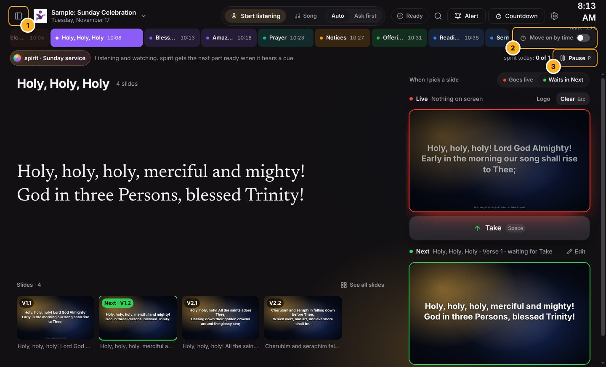

1. **Library** (top left): the Bible, your songs and your services, to pick from during the service.
2. **Move on by time**: when a part’s time is up, the next part loads by itself (into Next, or on screen if picking a slide goes live). The sermon, a verse on screen and a song being sung never move on by themselves.
3. **Pause** (or the P key): spirit stops getting things ready by itself until you press it again.

### The library

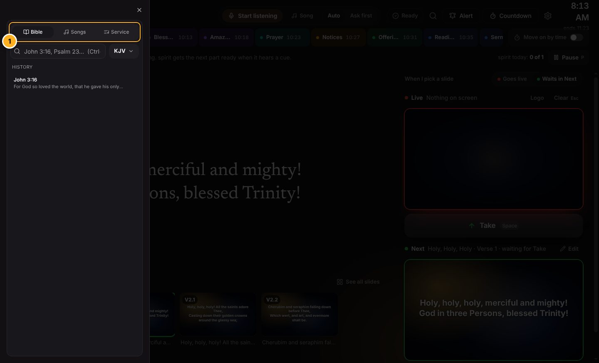

1. Three tabs: **Bible** (type a reference; *History* shows what was on screen), **Songs** (your song library) and **Service** (today’s services, coming up and earlier, each part with its slides). Click anything to pick it.

**Good to know**

- **Several services on the same day** sit side by side before the order of service; one click switches between them.
- The window can be any size: on a wide monitor the library stays open as a column on the left.

## 3. Watch the demo

The demo plays a short sermon and a hymn through the real listening engine. A voice says what is happening, and a pointer shows where.

### The demo explains each step

1. **The card** says what is happening; the same words are spoken. The speaker button turns the voice off.
2. **Stop the demo** ends it at any time.

### Following the reading

1. **The verse being read**, large, with the word being read underlined.
2. **Heard**: the last words Voice Verses heard.
3. **Live**: the verse went up because the preacher said “John chapter 3 verse 16”.
4. **Next**: the following verse is ready, in case the preacher reads on. It goes up when this verse ends.

## 4. Put a verse on the screens yourself

Three steps: find it, check it in Next, press Take.

### Search

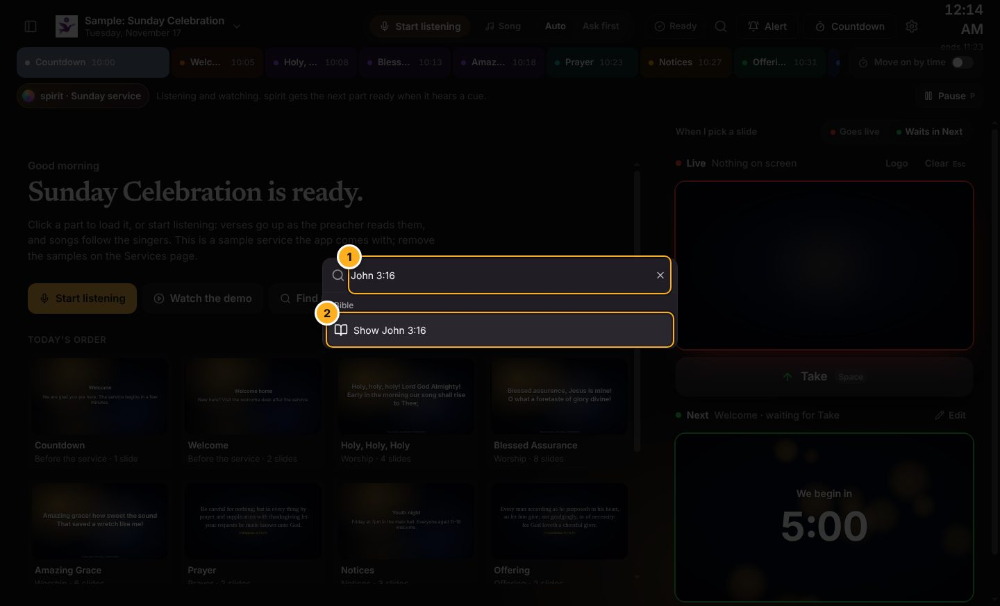

1. Press **⌘K** (Ctrl+K on Windows), or click the magnifying glass. Type the verse: *John 3:16*, *Psalm 23*, *Romans 8:28-39*.
2. Press **Return**, or click **Show John 3:16**.

### The verse waits in Next

1. **Next** shows exactly how it will look on the projector.
2. Press **Take** (or the Space bar) to put it on the screens.
3. **When I pick a slide** decides whether picking goes straight to the screens (*Goes live*) or waits in Next (*Waits in Next*).
4. The verse also shows large here, with the rest of the chapter underneath to pick from.

### On the screens

1. **Live** (red) now shows John 3:16, and so does the room.
2. **Clear** (Esc) takes the words off the screens.
3. **Logo** shows the church logo on every screen.
4. **KJV ▾** changes the translation of everything on screen and in Next.

**Good to know**

- Press **→** for the next verse and **←** for the one before.

## 5. Let it listen

Press Start listening and the preacher does the work.

### A suggestion

1. **The ring** shows how much of the verse’s wording was heard.
2. **Why** it was suggested, in plain words (most of it quoted, in today’s plan, the book was mentioned…).
3. **Show now** puts it straight on the screens.
4. **Use** puts it in Next, to check first. The × dismisses it. Click the bar to see every suggestion of the last few minutes.

**Good to know**

- **Said outright** (“John 3:16”, “John chapter 3 verse 16”, “Romans 8 from verse 28”): in *Auto* it goes straight up; in *Ask first* it waits in Next.
- **Read aloud**: each verse goes up as the reader gets to it, and the next one waits in Next.
- **Named without a verse** (“turn to Isaiah 53”): the chapter loads and waits until the preacher reads or names a verse.
- **Quoted or told in their own words**: offered as a **suggestion**. It never goes up by itself unless it is word for word (99% sure).
- **During songs**, press **♪ Song** so verses stay off the screen unless a reference is said outright.

## 6. Songs and slides

Songs, announcements and pictures come from the order of service.

### Load a part of the service

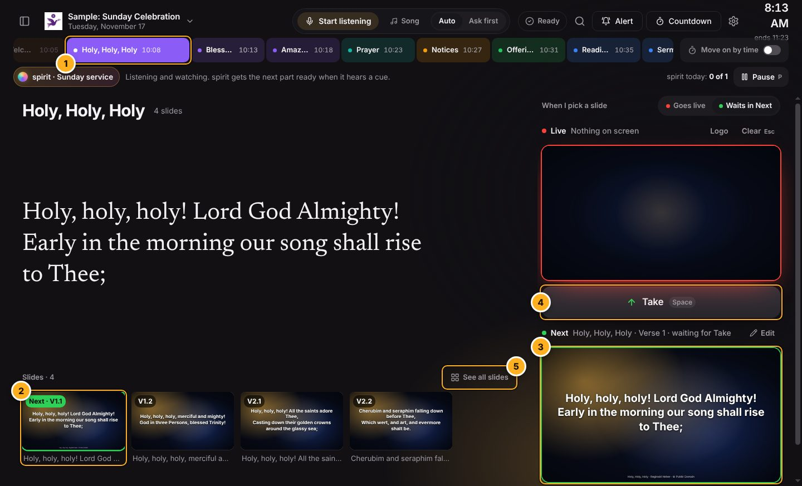

1. Click the part in the **order of service** (here, the hymn *Holy, Holy, Holy*).
2. Its **slides** appear along the bottom. Click one to pick it; double-click to show it at once.
3. The first slide waits in **Next**.
4. Press **Take** (Space) to show it, then Space again for each slide.
5. **See all slides** shows them as a grid.

### A song on the screens

1. **Live · V1.1**: the slide on the screens, framed red.
2. **Next · V1.2**: the slide that comes next, framed green.
3. **The pencil** (Quick edit) fixes a word or changes the look, even during the service.
4. **♪ Song**: while the church sings, the words follow the singers, and verses stay off the screen.

### Quick edit

1. Change the section name, the words or the **look**, and see how the room will see it. Press **Save**. For the full designer, press **Open the full designer**.

### Every slide as a grid

1. **Show the words large** goes back to the normal view.

**Good to know**

- The worship leader can call parts of the song out loud: “Verse two!”, “Back to the chorus”. Voice Verses goes there.
- New words that are in no song are offered as a new song, and kept as a draft afterwards.

## 7. Countdowns and alerts

Both buttons are at the top of the live screen and every other page.

### Countdown

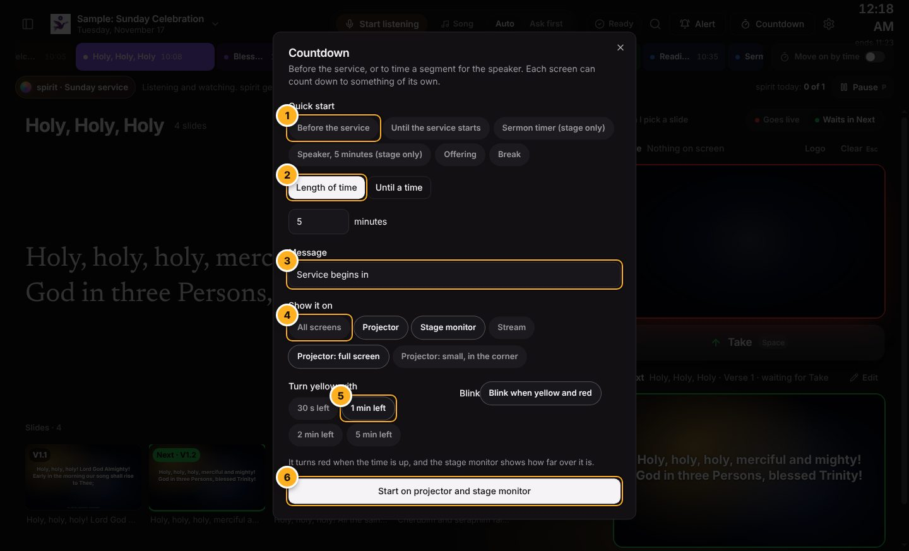

1. **Quick start**: before the service, until the service starts, a sermon timer (stage only), and more.
2. **Length of time** (5 minutes) or **Until a time** (10:00).
3. **Message** above the numbers, such as “Service begins in”.
4. **Show it on**: all screens, the projector, the stage monitor or the stream; full screen or small in the corner.
5. **Turn yellow with** 1 minute left; **Blink** when yellow and red. It turns red at zero, and the stage shows how far over it is.
6. **Start**. Several countdowns can run at once, each on its own screens.

### Alert: a message over whatever is on screen

1. **For the room**: nursery, children’s church, car lights, move a car, seats at the front.
2. **For the stage only**: five minutes, please wrap up, speak up, microphone.
3. Type the **child number** or number plate (or write any message).
4. **Show it on**: which screens.
5. **Hide it**: until you clear it, or after 15 seconds to 2 minutes.
6. **Amber** and **Blink** make it stand out. The preview shows how the projector will look; the button under it shows the alert. While one is up, the Alert button turns amber with an × to clear it.

## 8. Is everything ready?

The booth check looks at the microphone, the screens, ProPresenter, the Bible and today’s service every minute.

### The booth check light

1. **Ready** (grey tick) or **n to check** (amber). Click it.
2. Each check, with **Show me the fix**: the right Settings page opens with the one thing to change lit up and said in one line.

### Settings → Booth check

1. The **booth check** at the top of Settings.
2. **Set up your booth** finds everything again.

### Show me the fix

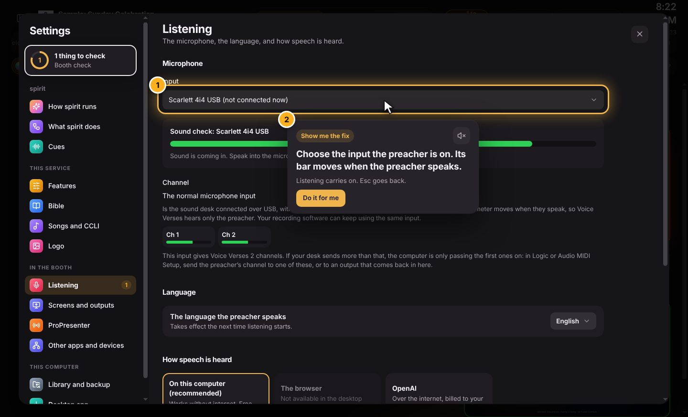

1. The one thing to change, lit up on the right page.
2. What to do, in one line (also said aloud). Listening carries on; **Esc** goes back.

**Good to know**

- During the service, a problem (a screen unplugged, no sound for 20 seconds) shows as an amber warning under the top bar, with **Show me the fix** and **Not now**.
- Listening carries on while you fix it. When the check passes you see a tick, and you are back on the live screen 2 seconds later. **Esc** goes back at any time.
- For the microphone, **Do it for me** listens to every input and chooses the one with the preacher’s sound.

## 9. Design how things look

A **look** is the design for one kind of thing on one screen: scripture on the projector, songs on the stream, and so on. Change a look and every slide that uses it changes, on the screens straight away. Open **Looks** from the page bar.

### Looks

1. Three tabs: **Design a look**, **Which screen uses what**, and **Colour teams and themes**. Click a look in the row to design it.
2. **Backgrounds**: moving backgrounds made by the app, and 40 ready-made samples.
3. **Starter looks**: ready-made designs to add and change.
4. **New look** starts one from nothing.

### The designer

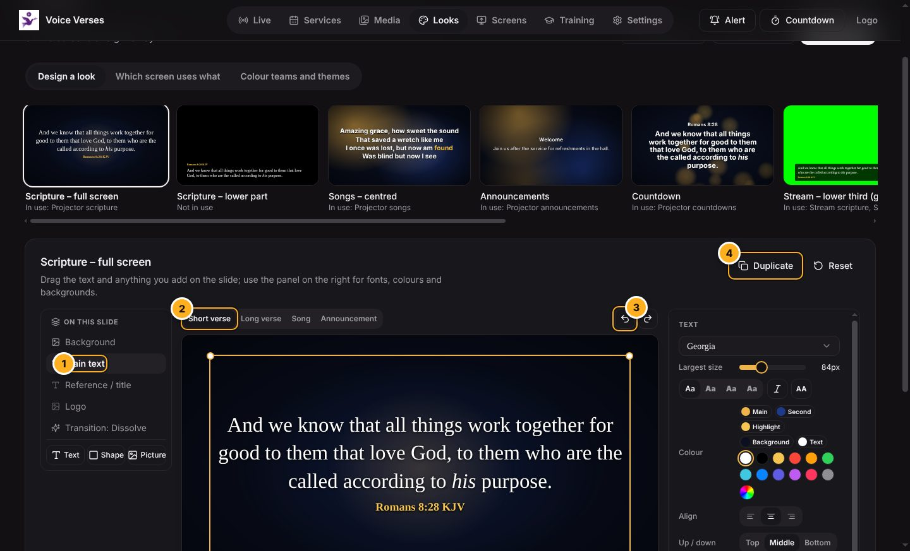

1. **On this slide**: click the part to change (Background, Main text, Reference / title, Logo, Transition). **Text**, **Shape** and **Picture** at the bottom add your own layers.
2. Try it with a **short verse**, a **long verse**, a **song** or an **announcement**, so it works for all of them.
3. **Undo** and **Redo** (⌘Z and ⇧⌘Z).
4. **Duplicate** makes a copy to change. **Reset** puts a built-in look back as it came.

### Change the background

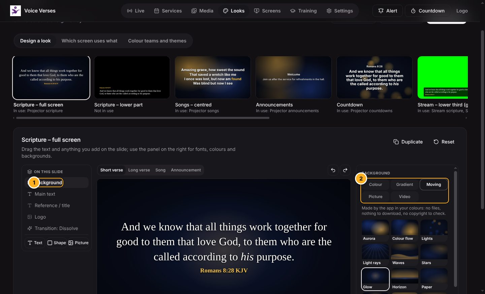

1. Click **Background**.
2. Choose **Colour**, **Gradient**, **Moving**, **Picture** or **Video**. Moving backgrounds are drawn by the app in your team’s colours, with a speed (0 is still). A picture or video can be dimmed and blurred so the words stay readable.

### Backgrounds

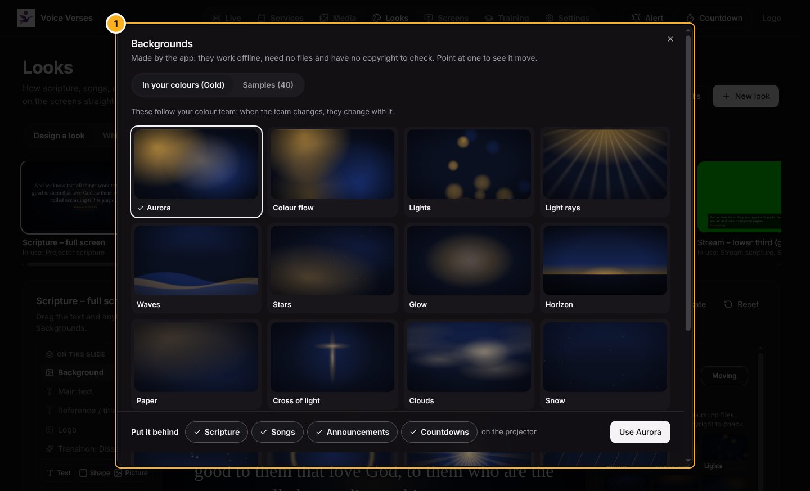

1. **In your colours** (they follow your colour team) or **Samples (40)**. Pick one, choose what it goes behind on the projector (**Scripture**, **Songs**, **Announcements**, **Countdowns**), then press **Use**.

### Starter looks

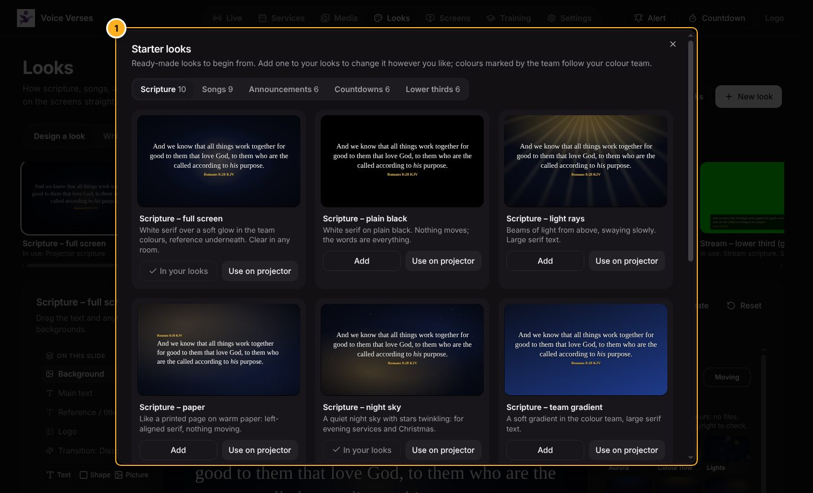

1. Tabs for Scripture, Songs, Announcements, Countdowns and Lower thirds. **Add** copies one into your looks; **Use on projector** puts it to work straight away.

### Which screen uses what

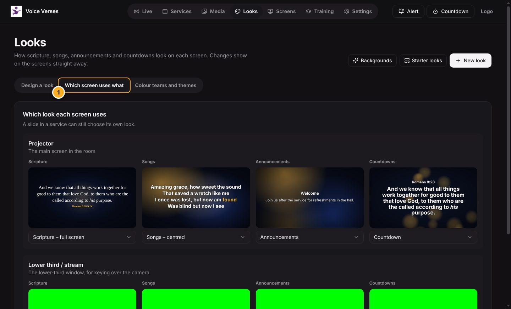

1. For each screen (the projector, the lower third for the stream, the stage), choose the look for **Scripture**, **Songs**, **Announcements** and **Countdowns**.

### Colour teams and themes

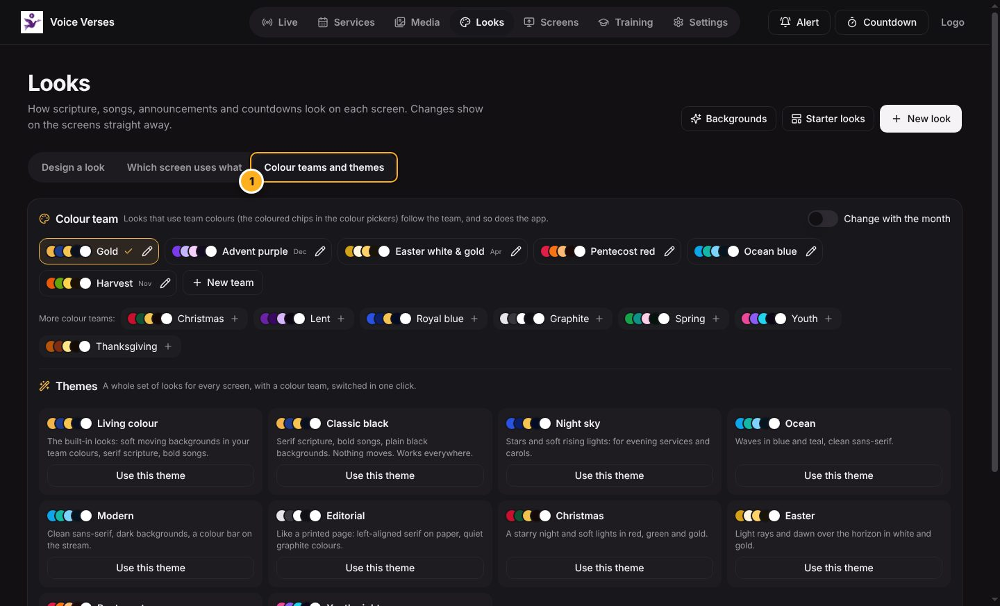

1. **Colour team**: five colours every look can use. Change the team and every look changes with it. **Change with the month** picks the team for the season (Advent purple in December, Easter in April). **More colour teams** adds Christmas, Lent, Youth and others; **New team** makes your own. **Themes** set every look and a colour team in one click (**Use this theme**).

### One slide, its own look

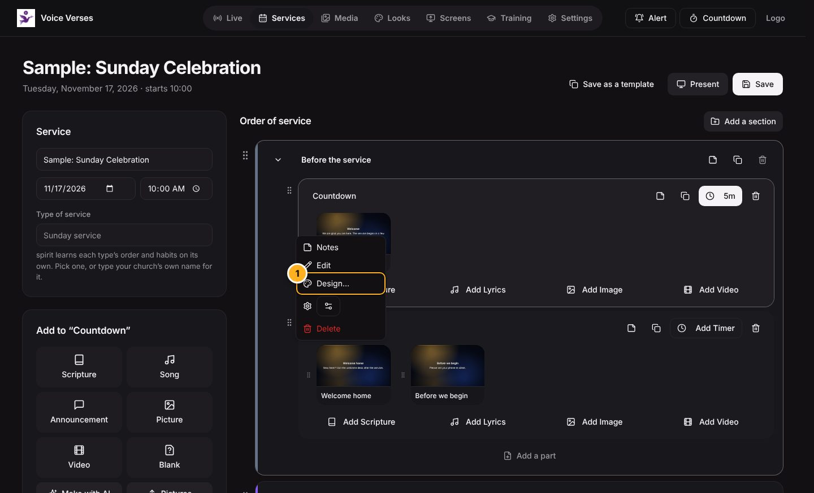

1. In the service editor, open a slide’s **⋮** menu and choose **Design…**

### Designing one slide

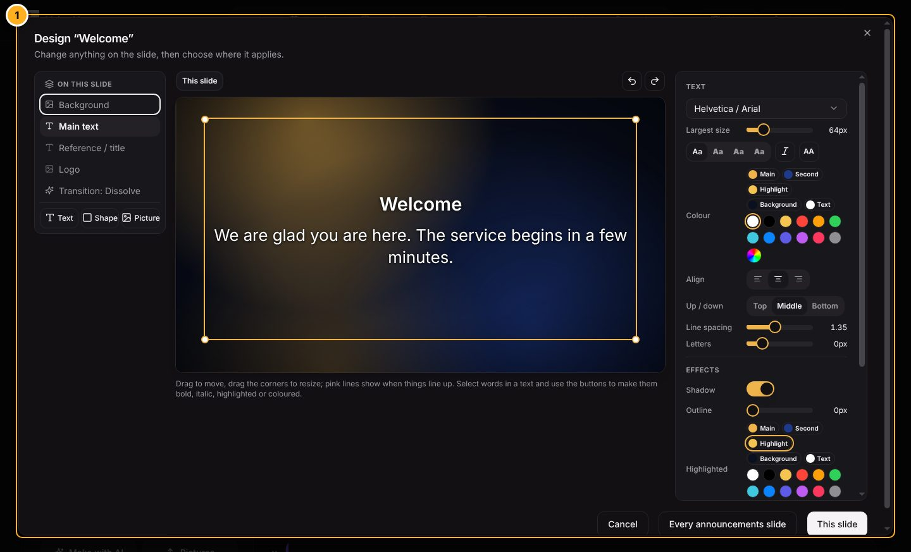

1. The same designer, for this slide. At the bottom, choose where it applies: **This slide**, or every slide of that kind (for example **Every announcements slide**).

**Good to know**

- **Move and resize**: drag the text box to move it, and its corners to resize it. Pink guide lines show when things line up.
- **The text panel** on the right: font, largest size (long verses shrink to fit), bold, italic, underline and highlight, colours (the team’s colours or any), alignment, up or down, line and letter spacing, shadow and outline, a box behind the text, and where it sits.
- **Single words**: select words in the text and use the bold, italic, underline, highlight or colour buttons.
- **Transitions**: click *Transition* in the list: dissolve, through black, lift, zoom, push or cut, from 0.2 to 3 seconds. A slide in a service can have its own.
- **During the service**: Quick edit (the pencil on a slide, or Edit above Live) changes a slide’s words or look on the spot.
- Slow computer? Settings → Screens and outputs → *Moving backgrounds on this computer* can keep them still.

## 10. Screens: projector, stream and stage

Voice Verses puts each output on its screen by itself, every time. Open Settings → **Screens and outputs** (or the **Screens** page).

### Screens and outputs

1. **Screens and outputs** in the sidebar.
2. **Click a screen** in the picture of the room.
3. Choose what it **shows**: Projector, Lower third, Stage monitor or Nothing. It opens there by itself, every time.
4. **Identify screens** puts a big number on every screen.

### Screens on the network

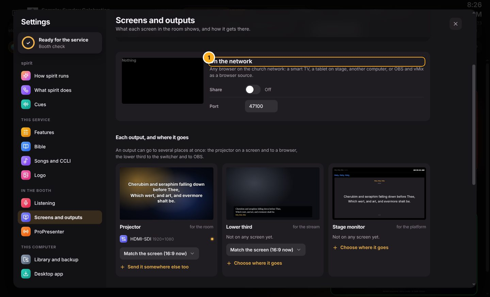

1. Click **On the network** in the picture of the room and switch **Share** on. Any browser on the church network can then show an output: a smart TV, a tablet on stage, another computer, or OBS and vMix as a browser source. The addresses it shows can be copied; the port is 47100.

### NDI® on the network

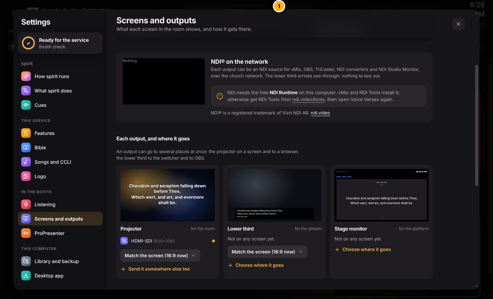

1. Click **NDI on the network**. Each output can be an NDI source for vMix, OBS, TriCaster, NDI converters and ProPresenter; the lower third goes see-through. It needs the free **NDI Runtime** on this computer (NDI Tools, from ndi.video/tools).

### Each output, and where it goes

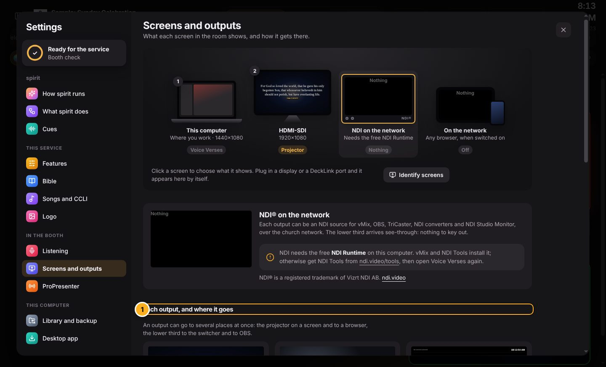

1. Every output with its picture, where it is shown, its **screen shape** (match the screen, 16:9, 16:10, 4:3, ultrawide or your own size) and **Send it somewhere else too**: one output can go to a screen and a DeckLink port and the network at once.

### Ways to connect a screen

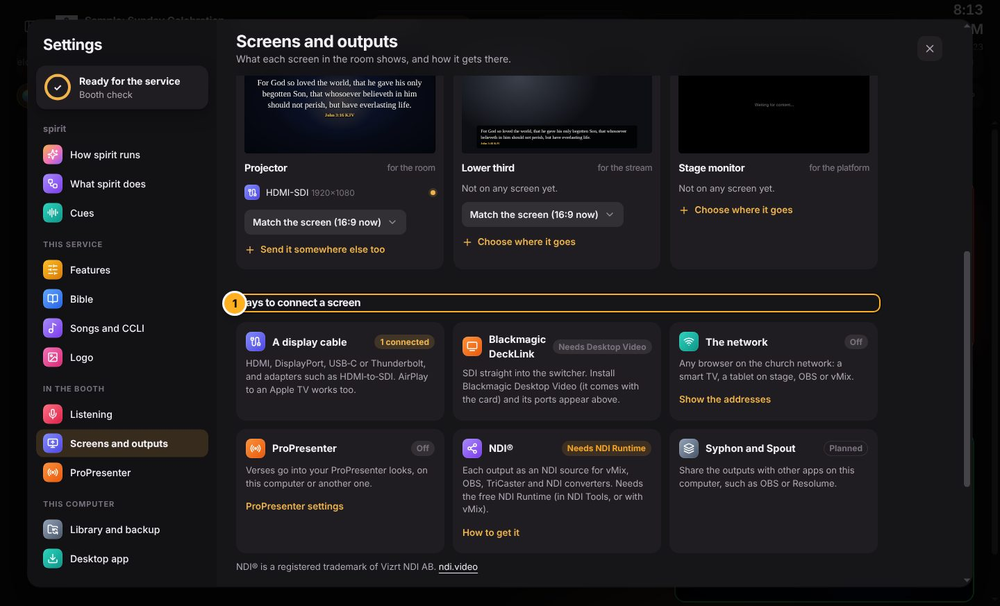

1. **Ways to connect a screen**: a display cable (HDMI, DisplayPort, USB‑C, AirPlay), **Blackmagic DeckLink** (SDI straight into the switcher; choose the video format your switcher uses and press *Show test colours*), the network, ProPresenter and NDI. Each says whether it is ready.

### The stage monitor’s own settings

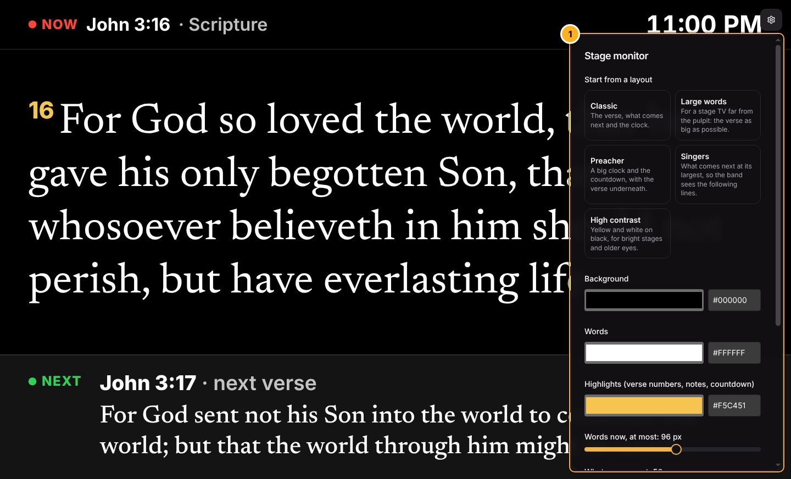

1. On the stage monitor, move the mouse and click the gear. **Start from a layout** (Classic, Large words, Preacher, Singers or High contrast), then change colours and sizes. **Show what comes next** at Off shows only what is on. Sizes are for a 1920 × 1080 screen: the stage monitor scales to any TV.

**Good to know**

- Esc on an output that sits on your own screen turns it off.
- If a screen is unplugged, its output comes back by itself when it is plugged in again, and the booth check says so meanwhile.
- An HDMI-to-SDI converter on a spare video output works too, like any other screen.

## 11. ProPresenter: three ways to connect

ProPresenter is optional: Voice Verses’ own screens keep working whichever way you choose, and nothing is sent while you practise. Open Settings → **ProPresenter** and choose how the words get there.

### Way 1: a slide with linked text (recommended for most churches)

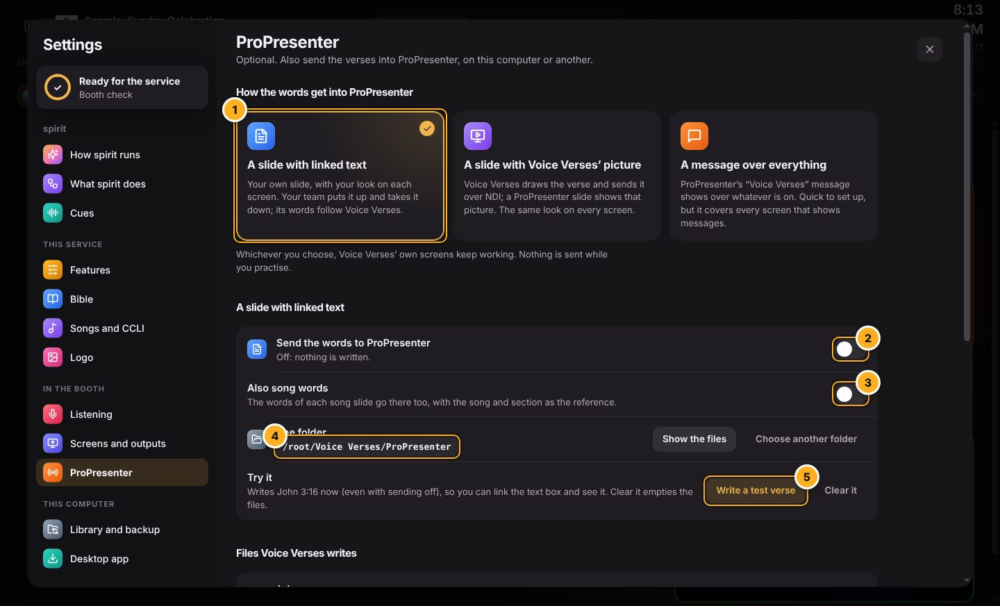

1. Choose **A slide with linked text**. Your team keeps control: they put the slide up and take it down, and each screen keeps its own look.
2. **Send the words to ProPresenter**: on for the service.
3. **Also song words**: song slides go there too, if you want.
4. **The folder** where Voice Verses writes the words. **Show the files** opens it. If ProPresenter is on another computer, press **Choose another folder** and pick a folder both computers can see (a shared folder, or a Dropbox, iCloud or OneDrive folder).
5. **Write a test verse** writes John 3:16 now (even with sending off), so you can link the text box and see it. **Clear it** empties it.

### Way 1, in ProPresenter (once)

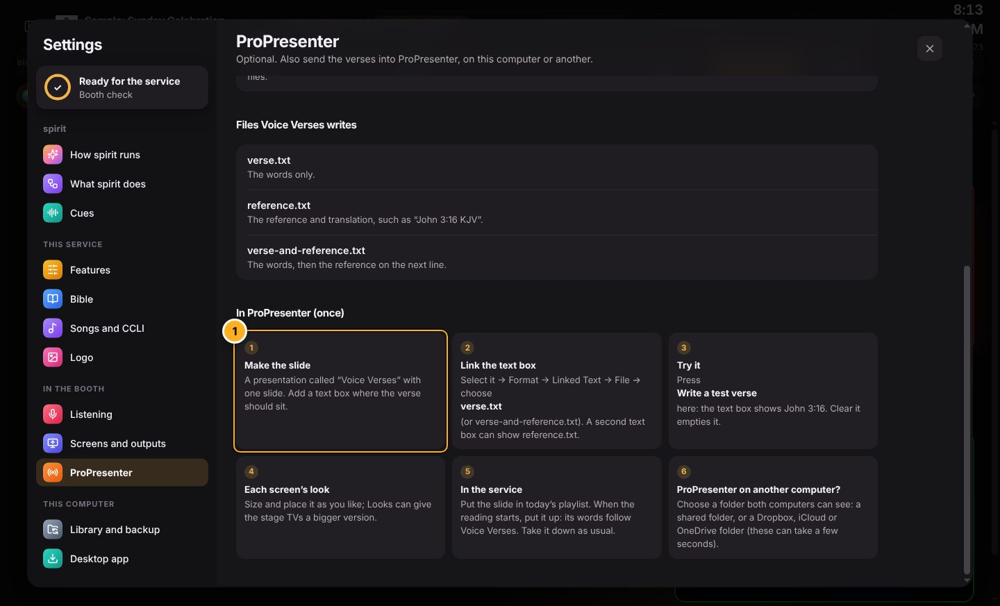

1. The page lists the six steps: **make a slide** called “Voice Verses” with a text box; select the text box → **Format → Linked Text → File** → choose **verse.txt** (or *verse-and-reference.txt*; a second box can show *reference.txt*); press **Write a test verse** here and the box shows John 3:16; give it the look you want on each screen; in the service, **put the slide up** when the reading starts, and its words follow Voice Verses.

### Way 2: a slide with Voice Verses’ picture

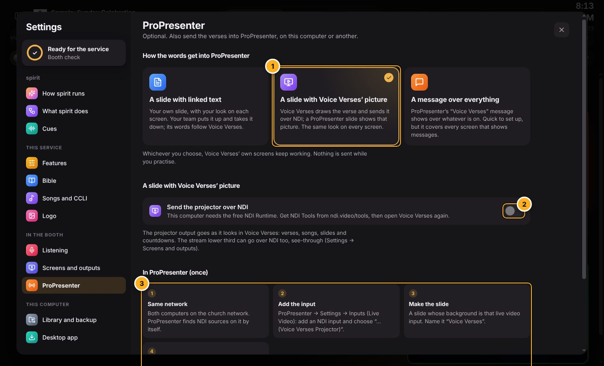

1. Choose **A slide with Voice Verses’ picture**. ProPresenter shows exactly what Voice Verses draws: verses, songs, slides and countdowns, with the same look on every screen.
2. Switch on **Send the projector over NDI**. This computer needs the free NDI Runtime (NDI Tools, from ndi.video/tools).
3. In ProPresenter, once: **Settings → Inputs**, add an NDI input and choose “… (Voice Verses Projector)”; then make a slide whose background is that input, and put it up when the reading starts.

### Way 3: a message over everything

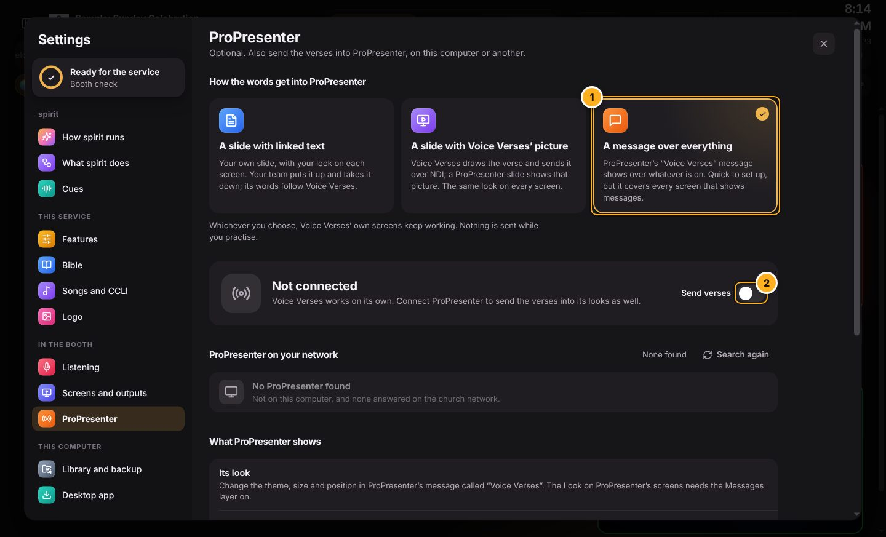

1. Choose **A message over everything**. It is the quickest to set up, but the message shows over every screen whose Look has Messages on.
2. Switch **Send verses** on. Under it, **ProPresenter on your network** lists every ProPresenter found; press **Connect** beside yours. Voice Verses makes the “Voice Verses” message with a lower-third theme.

### Way 3: what ProPresenter shows

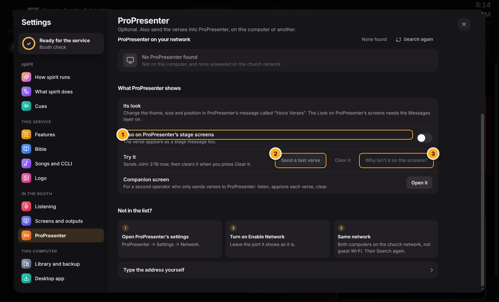

1. **Also on ProPresenter’s stage screens** sends a stage message as well.
2. **Send a test verse**, then **Clear it**.
3. **Why isn’t it on the screens?** lists what ProPresenter says (the message, its layers and the Look on each screen) and what to change.

**Good to know**

- **Which way?** Linked text if your team runs ProPresenter and wants its own looks and control. The NDI picture if you want Voice Verses’ look (and songs and slides) inside ProPresenter. The message only for a quick start.
- **Clear** (Esc), the **Logo**, or a song or slide going up takes Voice Verses’ verse off ProPresenter (linked text: the files are emptied).
- With the message: if someone presses **Hide** in ProPresenter, Voice Verses stops sending and offers **Send again**.
- **ProPresenter not found?** In ProPresenter: Settings → Network → Enable Network, on the same network. Or type its address (Not in the list? → Type the address yourself).
- The booth check checks the way you chose: the folder, the NDI picture, or the message.

## 12. Other apps and devices

A Stream Deck, a phone, or your church’s own apps (a dashboard, Planning Center, a captioning tool) can use Voice Verses over the church network. Each one is paired once, with a code shown on this computer, so only devices someone in the booth paired can use it. It needs the desktop app, and it works without the internet.

### Turn it on

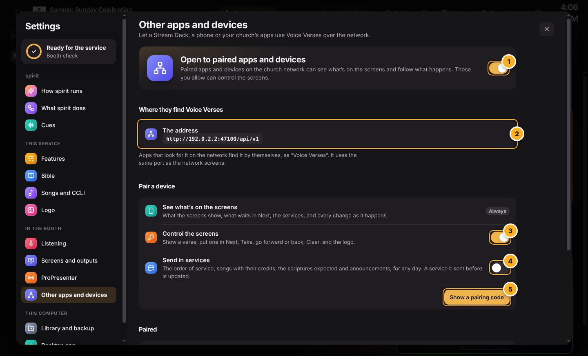

1. Settings → **Other apps and devices**: switch it on. Switch it off and no other app can use Voice Verses (the network screens have their own switch).
2. **The address** other apps use. Most find Voice Verses on the network by themselves.
3. **Control the screens**: on, the device you pair next can show verses, Take, go forward or back, Clear and show the logo. Off, it can only see what’s on and follow what happens.
4. **Send in services**: on for an app that plans your services (the CCCG Dashboard, Planning Center, your church’s own app). It can send a whole service for any day: the order, songs with their credits, the scriptures expected and announcements.
5. **Show a pairing code**.

### Pair a device

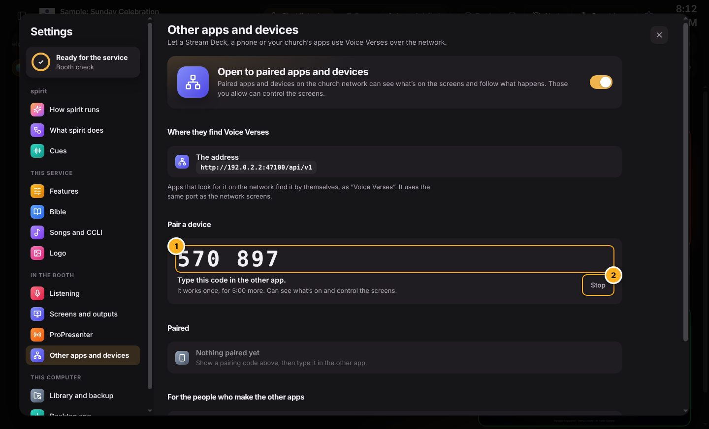

1. Type these six digits in the other app. The code works once, for five minutes.
2. **Stop** if you change your mind.

### What is paired

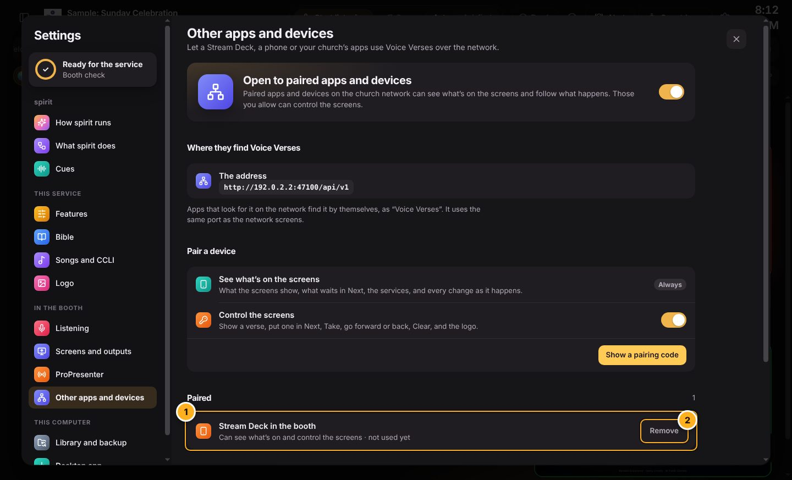

1. Each paired device, what it may do, and when it last used Voice Verses. Places it sends events to are listed under it, with **Stop sending**.
2. **Remove** ends that device’s access at once. To pair it again, show a new code.

**Good to know**

- **A Stream Deck:** add the Voice Verses module to Bitfocus Companion (the file **voice-verses-companion.tgz** comes with each release) and type the pairing code in its connection. Its ready-made buttons Take, Clear, show the logo, go back and forward and show a verse; Take lights green while something waits in Next, Clear red while something is on the screens. Step by step: [Stream Deck buttons](../integrations/stream-deck.md).
- A remote **Take** does exactly what the Take button does. While you practise in Training, other apps can’t change the screens.
- A service sent in appears in **Services** on its day, marked **From** and the app’s name, and you see a message when it arrives. Sending it again updates it. Its scriptures expected are in the sermon, so detection finds them more easily, and loading them puts the first verse in Next.
- A service saved as a file by another app (a **service package**, .json) imports with **Services → Import**.
- For the people who make the apps: the page links to **the guide for developers** (the API, its events, webhooks and the service package).

## 13. Settings, page by page

Open Settings with the gear. Everything saves as you change it; there is no Save button to forget. Screens and ProPresenter have their own sections above.

### Features: what Voice Verses does by itself

1. **Features** in the sidebar.
2. Choose **Essentials**, **Recommended** or **Everything**.
3. Or switch each feature on or off. A verse said outright always goes up, whatever is off.

### Listening: the microphone

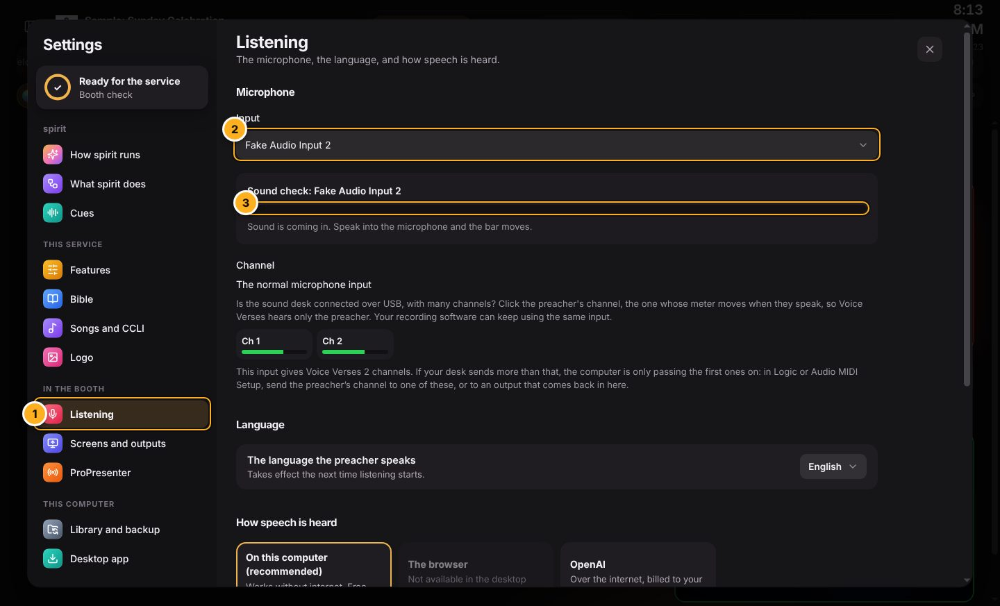

1. **Listening** in the sidebar.
2. **Input**: the microphone or the sound desk’s USB feed.
3. **Sound check**: speak and the bar moves. If the desk sends many channels, click the preacher’s channel (its meter moves when they speak).

### Listening: how speech is heard

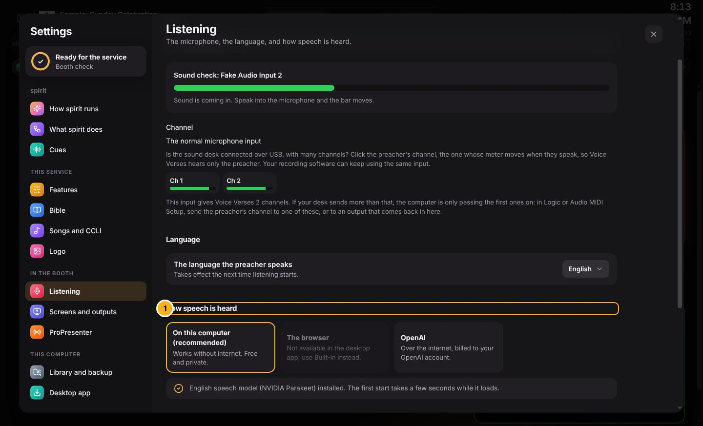

1. **How speech is heard**: *On this computer* (recommended: offline and private), *The browser* (the web version only) or *OpenAI* (over the internet, with your own key).

### Listening: test a recording, and the AI assistant

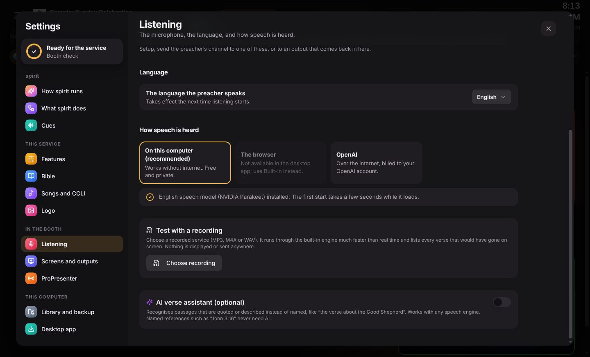

**Test with a recording**: choose a recorded service (MP3, M4A or WAV) and see every verse Voice Verses would have shown. **AI verse assistant** (optional): with Claude, OpenAI, Ollama or LM Studio on your own computer, or another compatible server, it also recognises verses quoted or described instead of named. Keys are kept in the computer’s own keychain, never in the web version.

### Bible translations

1. **Bible** in the sidebar.
2. **On this computer**: KJV, ASV, WEB, or your own. Always works, no internet needed. **Your own** → **Add a Bible file** takes a Bible in OSIS, USFX, Zefania or USFM (a file, or the .zip eBible.org gives you) or JSON, and shows it by its own short name. Only add a Bible your church may use: public domain, or licensed to you.
3. **Over the internet**: ESV, NLT and API.Bible translations (NKJV, NIV, CSB…), each with a free key from its publisher.

### Songs and CCLI

1. **Songs and CCLI** in the sidebar.
2. Your **CCLI licence number**, shown small on each song’s first slide with its writers and copyright.

### Logo

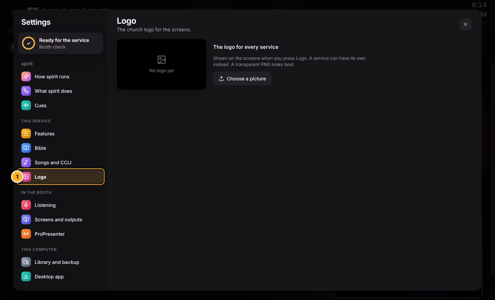

1. **Logo** in the sidebar. **Choose a picture**; a transparent PNG looks best. The Logo button shows it on every screen.

### Library and backup

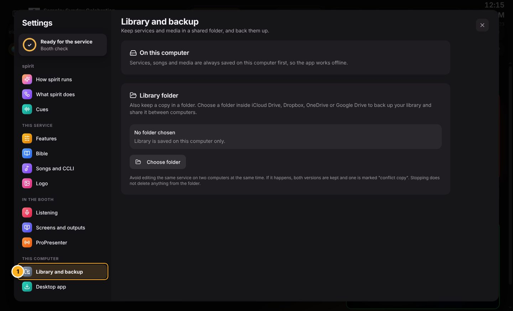

1. **Library and backup** in the sidebar. **Choose folder** inside iCloud Drive, Dropbox, OneDrive or Google Drive to back up your services and share them between computers.

### Desktop app

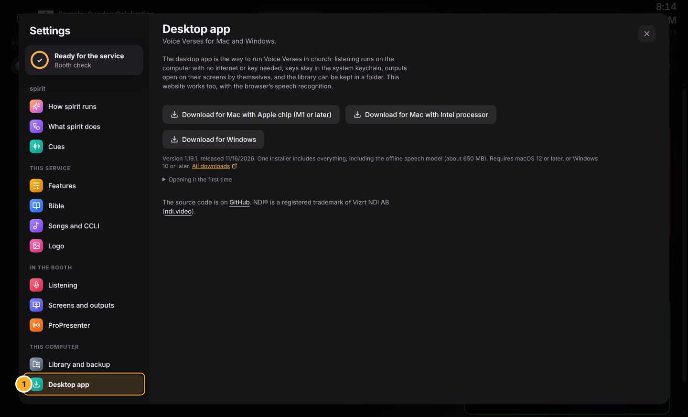

1. **Desktop app** in the sidebar. **Updates** at the top: the version on this computer and whether a newer one is out. Voice Verses looks when it opens and every 4 hours; **Check now** looks at once. On Windows it downloads by itself, then **Restart to update** (or it installs when you quit). On a Mac, **Download** puts the new installer in Downloads, then **Open the installer**: quit Voice Verses, drag it to Applications and choose Replace. A new version also shows beside Desktop app in this list, with a message. Below: downloads for Mac (Apple chip or Intel) and Windows, each one installer with everything, the offline speech engine included.

## 14. spirit: let it run the service

spirit learns how your church runs its service, gets the next thing ready, and earns your trust one move at a time. It never puts a verse up that wasn’t said.

### When spirit gets something wrong

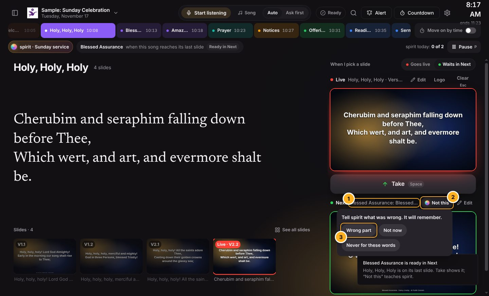

1. spirit put **Blessed Assurance** in Next because the last slide of the song before it went up. Next says why.
2. **Not this** tells spirit it was wrong.
3. Say why in one tap: **Wrong part**, **Not now** or **Never for these words**. spirit remembers.

### How spirit runs

1. **How spirit runs** in the sidebar.
2. **How much spirit does**: *Off*; *Ready in Next* (it gets things ready and you press Take); *Hands-free* (only for moves that have been right 10 times in a row).
3. **Your last service**: what spirit got right, what you chose, what you corrected.
4. **What spirit knows**.

### What spirit does

1. **What spirit does** in the sidebar.
2. **Spoken cues**: moments and sermon points.
3. **Before and after the service**: the countdown into the next part, and more coming soon.
4. **Songs**: the next song when one ends.

### Cues: teach spirit your church’s words

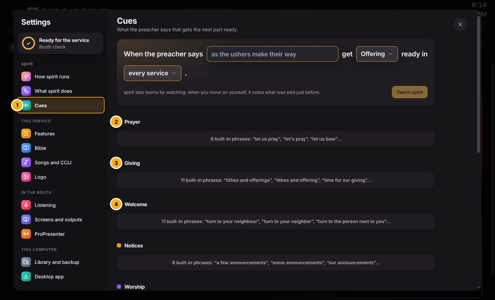

1. **Cues** in the sidebar. At the top, fill in the sentence: *When the preacher says* “as the ushers make their way” *get* Offering *ready*, then press **Teach spirit**.
2. **Prayer**: the phrases spirit already knows for prayer (“let us pray”, “bow your heads”…).
3. **Giving**: “tithes and offerings”, “receive the offering”…
4. **Welcome**, and below it every other moment of the service, each with its phrases.

**Good to know**

- spirit also learns by watching: when the same words keep coming before the same part, it suggests them as a new cue.
- If spirit gets something wrong, press **Not this** beside Next and say why (wrong part, not now, never for these words). It remembers.
- **Pause** (P) on the live screen hands everything back to you at once.
- When listening stops, **How it went** shows spirit’s score, with **Just this once** to undo a correction.

## 15. Plan your services

Open **Services** from the page bar (or the service name on the live screen).

### Services

1. The **page bar**: Live, Services, Media, Looks, Screens, Training, Settings. Pick a day in the calendar; its services show under it.
2. **New service**.
3. **Import** a service saved to a file (from another computer or church).
4. **Copy for next Sunday** makes a fresh copy.
5. **Save to a file**, to send or keep.
6. **Present** opens it to run; **Edit** opens the editor.

### Templates and ready-made orders

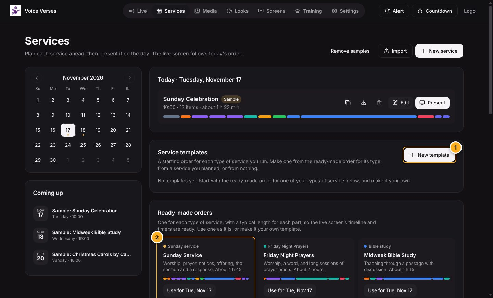

1. **New template**: your own order of service for a type of service, from a ready-made order, a service you have, or nothing.
2. **Ready-made orders**: one for every type of service. **Use for** the chosen day, or **Make it a template**.

### The service editor

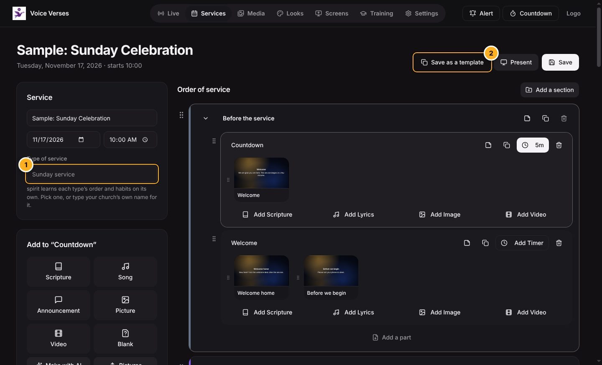

1. **Type of service** (Sunday service, Communion Sunday, Friday Night Prayers…). spirit learns each type separately.
2. **Save as a template** keeps this service as a starting point for next time.
3. **Present** runs it.
4. **Save**.

### Add to a part

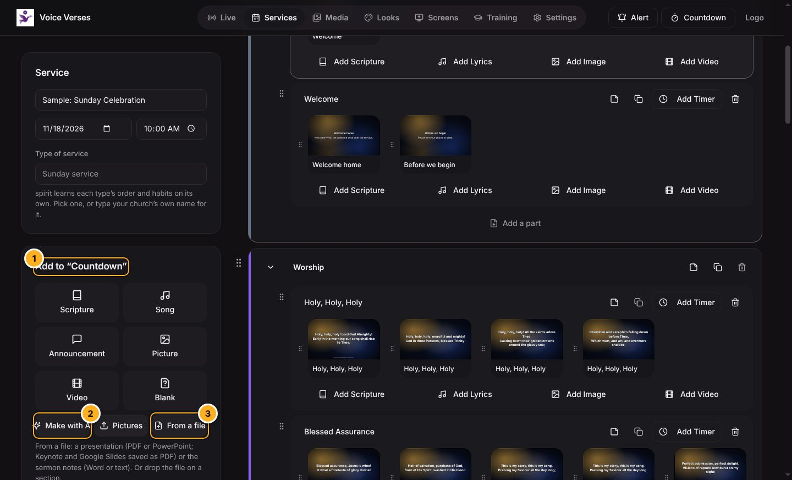

1. Click a part in the order, then **Add to “…”**: Scripture, Song, Announcement, Picture, Video or Blank. Drag parts and slides to reorder; each part has a timer for the timeline.
2. **Make with AI** turns the bulletin or sermon notes into slides.
3. **From a file** adds a presentation or the sermon notes to the section (or drop the file on a section).

### Add from a file: a presentation or the sermon notes

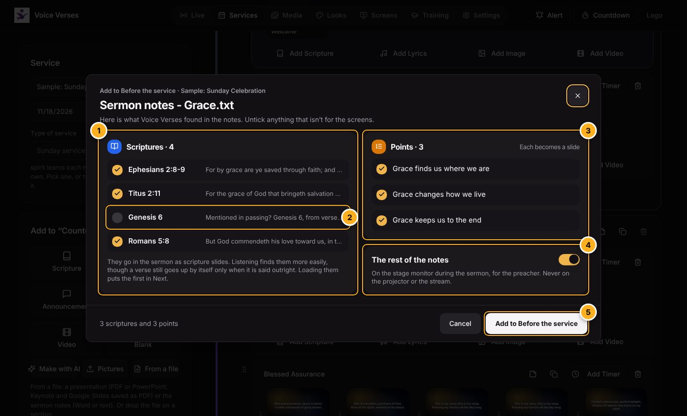

1. **Scriptures** written in the notes, each with its first words. They go in as scripture slides, so listening finds them more easily (a verse still goes up by itself only when it is said outright), and loading them puts the first in Next.
2. A chapter alone (“like Noah in Genesis 6”) is often mentioned in passing, so it starts unticked. Tick it if it is read.
3. **Points**: the headings and numbered lines. Each becomes a slide.
4. **The rest of the notes** go to the stage monitor during the sermon, for the preacher. Never to the projector or the stream.
5. **Add** puts them in the section as parts. Then **Save** the service.

### Make slides with AI (optional)

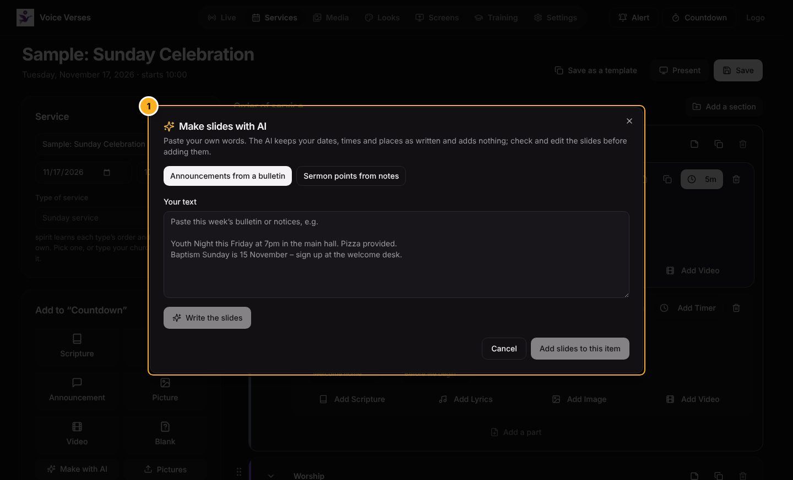

1. **Announcements from a bulletin** or **Sermon points from notes**: paste the words, press **Write the slides**, check them, then **Add slides to this item**. It needs an AI provider (Settings → Listening → AI verse assistant); it keeps your dates, times and places as written.

**Good to know**

- A part can have its own **countdown** that starts with its first slide (the Countdown before the service does this).
- **Remove samples** takes away the sample services and songs the app came with.
- **From a file**, a presentation: a **PDF** comes in as pictures, exactly as made (Keynote and Google Slides: save as PDF), or as words in your church’s look. A **PowerPoint** (.pptx) comes in as words and pictures in your look, with its speaker notes for the stage; for an exact copy, save it as PDF first. Untick any pages you don’t want. Scriptures written on the slides go in too.
- **Notes on the stage monitor**: a slide’s own notes, or its part’s, show on the stage monitor under the slide while it is up (the notes button on a part or slide). Never on the projector or the stream.

## 16. Media, the Screens page and Presenter

### Media

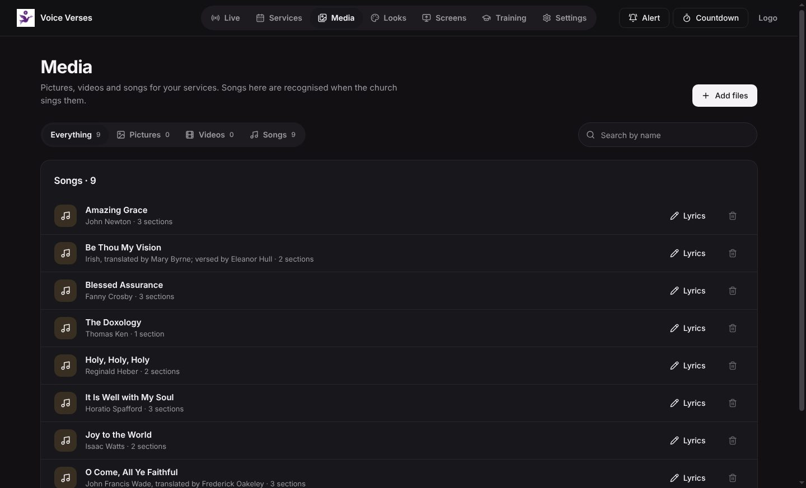

1. **Add files**: pictures, videos, and SongSelect songs (.usr or .txt), kept with their writers, copyright and CCLI number.
2. Show **Everything**, **Pictures**, **Videos** or **Songs**, or search by name.
3. **Lyrics** opens a song’s words.

### A song’s words

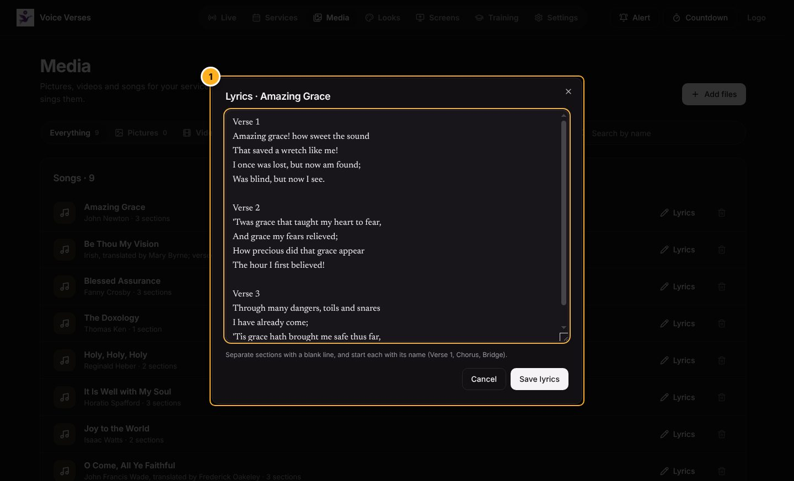

1. Start each section with its name (Verse 1, Chorus, Bridge) and leave a blank line between sections. **Save lyrics**. Songs in your library are recognised when the church sings them.

### Screens

**Right now**: what each screen shows. Below it, the same settings as Settings → Screens and outputs.

### Presenter

Every slide of the service by section. Click one to show it; **Start presenting** and **Clear to Logo** at the top.

## 17. Training

Short lessons on the real screens, in practice: nothing reaches the projector, the stream, the stage or ProPresenter. Each lesson and the demo first asks whether to play the guide’s voice. During a service the guide is never heard.

### Training

1. **Training** in the page bar (or the Training button on the live screen).
2. **Show me**: Voice Verses does each step, with a pointer and a voice.
3. **Let me try**: you do each step; it waits and checks.
4. **Watch**: the demo, explained aloud.
5. Lessons by who they are for: **Everyone** (your first Sunday, the demo, when something goes wrong), **Setting up** (set up your booth, screens and outputs) and **Before Sunday** (plan a service from a template, songs and slides, teach spirit a cue). Let me try in *Plan a service* plans a real service; delete it from the day if you don’t want it. In *Songs and slides*, Quick edit is opened and then cancelled, so no song changes unless you press Save yourself.

### Hear the guide?

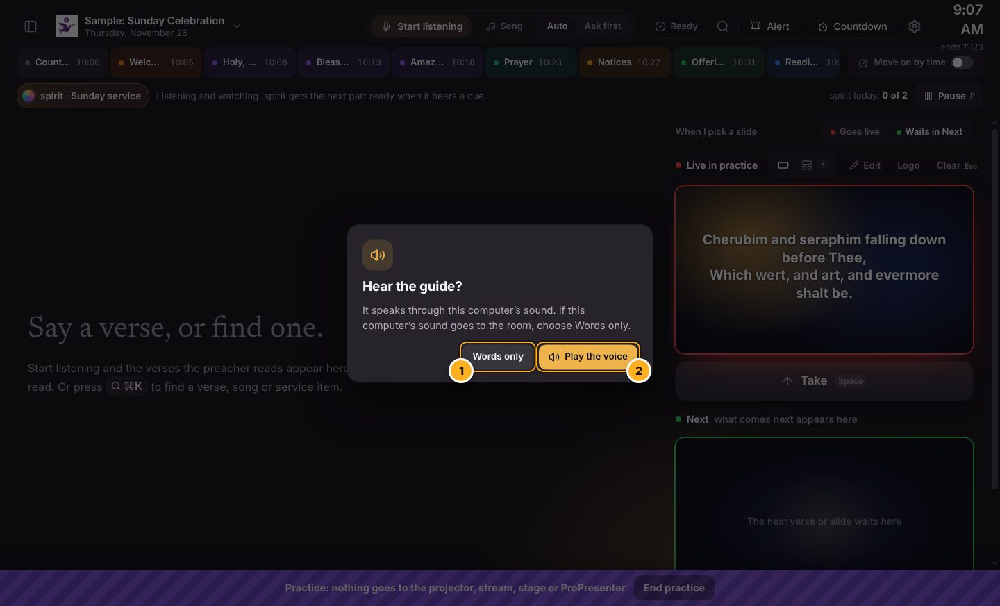

1. **Words only**: the lesson shows each step on its card, silently. Choose it if this computer’s sound goes to the room. Esc does the same.
2. **Play the voice**: each step is also said aloud, in the guide’s recorded voice.

### Show me

1. **The step**, on a card beside the control. **Back**, **Pause**, and **Let me try this step**.
2. **The speaker** turns the voice on or off. The × (or Esc) leaves the lesson.
3. **End practice** on the violet band stops the lesson.

### Let me try

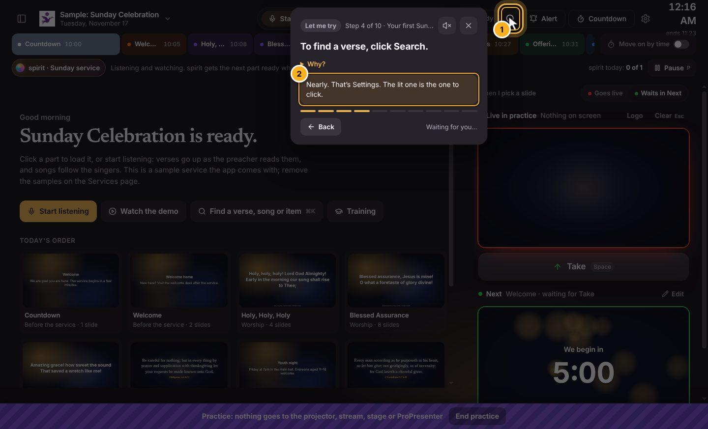

1. **The lit control** is the one to click.
2. Click somewhere else and it says what you clicked, and nothing changes. After two tries it offers **Show me this step**.

## 18. What the room sees

### The projector

Scripture, songs and slides in their look, with countdowns and alerts on top.

### The stage monitor

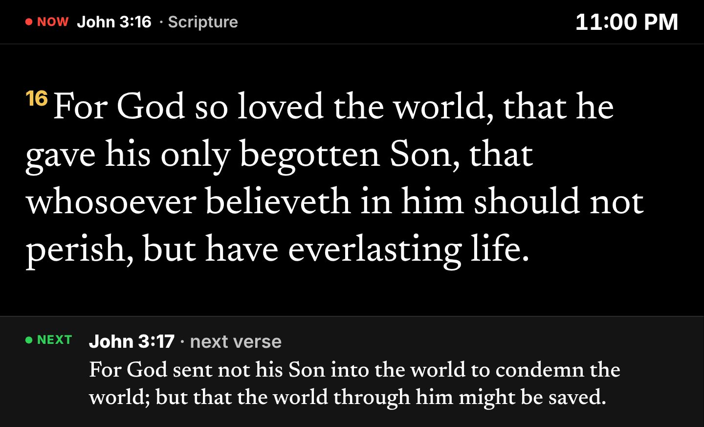

**Now**, at the top: what is on the screens and its part (Romans 8:28 · Scripture, or a song and its verse), with the clock and any stage countdown. The words themselves fill the screen. **Next**, along the bottom: what comes next, named by its part (Verse 2, the next reading), large enough to read from the platform. On the last slide of a song, Next is the next part of the service.

### The stream lower third

The verse on a green key colour for the stream switcher. Over NDI it goes see-through.

## Keyboard

| Key | What it does |
| --- | --- |
| Space or Return | Take: put Next on the screens |
| Esc | Clear the words off the screens |
| → and ← | Next or previous verse or slide |
| ⌘K (Mac), Ctrl+K (Windows) | Search |
| P | Pause or resume spirit |
| Double-click a slide | Show it now |

## When something goes wrong

| If… | Do this |
| --- | --- |
| Nothing happens when the preacher speaks | Look at the booth check light. In Settings → Listening, check the input and speak: the bar must move. With a desk feed, click the preacher’s channel. |
| A screen is black or on the wrong display | Settings → Screens and outputs → Identify screens, then click the screen and choose what it shows. |
| A wrong verse was suggested | Press × on the suggestion. Suggestions never go up by themselves. Switch to Ask first if you want every verse to wait in Next. |
| spirit got the wrong part ready | Press Not this beside Next and say why. Press P to pause spirit. |
| ProPresenter’s message covers its screens | Choose A slide with linked text in Settings → ProPresenter: your team then puts the verse slide up and takes it down. For now, Hide the message in ProPresenter: Voice Verses stops sending until you choose Send again. |
| Something went up by mistake | Press Esc to clear, or the Logo button. |
| You want to practise | Training → Your first Sunday → Let me try. Nothing reaches the room. |

## Every feature, and where to find it

| Feature | In this guide |
| --- | --- |
| Set up your booth on a new computer; open again from Booth check | [1. Set up your booth (the first time)](#setup) |
| The live screen: Live, Next, Take, Clear, Logo | [2. The live screen at a glance](#live) |
| When I pick a slide: Goes live / Waits in Next | [2. The live screen at a glance](#live) |
| Auto / Ask first | [2. The live screen at a glance](#live) |
| Library: Bible, songs, services; History | [2. The live screen at a glance](#live) |
| Several services on one day | [2. The live screen at a glance](#live) |
| Move on by time | [2. The live screen at a glance](#live) |
| The narrated demo | [3. Watch the demo](#demo) |
| Search (⌘K) for verses, songs, parts and actions | [4. Put a verse on the screens yourself](#verse) |
| Translation switch (KJV ▾) on the live screen | [4. Put a verse on the screens yourself](#verse) |
| Next and previous verse with the arrow keys | [4. Put a verse on the screens yourself](#verse) |
| Listening: verses said outright, read aloud, ranges, a chapter waiting for its verse | [5. Let it listen](#listening) |
| Suggestions for quotes and stories, with how sure and why; all suggestions | [5. Let it listen](#listening) |
| Song mode (♪ Song) | [6. Songs and slides](#songs) |
| Songs follow the singers; worship leader’s cues; new singing captured | [6. Songs and slides](#songs) |
| Slide strip, grid, double-click to show | [6. Songs and slides](#songs) |
| Quick edit during the service | [6. Songs and slides](#songs) |
| Countdowns (several, per screen, yellow and red, blink) | [7. Countdowns and alerts](#countdowns) |
| Alerts (nursery, car, stage notes) | [7. Countdowns and alerts](#countdowns) |
| Booth check and warnings during the service | [8. Is everything ready?](#booth-check) |
| Looks: the designer (text, layers, shapes, pictures, undo) | [9. Design how things look](#looks) |
| Backgrounds: colour, gradient, moving, picture, video; the gallery and samples | [9. Design how things look](#looks) |
| Transitions | [9. Design how things look](#looks) |
| Starter looks | [9. Design how things look](#looks) |
| Which screen uses what | [9. Design how things look](#looks) |
| Colour teams, change with the month, themes | [9. Design how things look](#looks) |
| A slide’s own look | [9. Design how things look](#looks) |
| Formatting single words | [9. Design how things look](#looks) |
| Screens and outputs: each output on its display; Identify screens | [10. Screens: projector, stream and stage](#screens) |
| Screen shapes and ultrawide | [10. Screens: projector, stream and stage](#screens) |
| Screens on the network (browsers, smart TVs, OBS, vMix) | [10. Screens: projector, stream and stage](#screens) |
| NDI® output | [10. Screens: projector, stream and stage](#screens) |
| Blackmagic DeckLink SDI output | [10. Screens: projector, stream and stage](#screens) |
| Stage monitor layouts and settings | [10. Screens: projector, stream and stage](#screens) |
| Moving backgrounds on a slow computer | [9. Design how things look](#looks) |
| ProPresenter: a slide with linked text | [11. ProPresenter: three ways to connect](#propresenter) |
| ProPresenter: a slide with Voice Verses’ NDI picture | [11. ProPresenter: three ways to connect](#propresenter) |
| ProPresenter: the message; stage message; Why isn’t it on the screens? | [11. ProPresenter: three ways to connect](#propresenter) |
| ProPresenter found on the network; type the address | [11. ProPresenter: three ways to connect](#propresenter) |
| Other apps and devices: pairing, control, the API for developers | [12. Other apps and devices](#devices) |
| Services sent in by other apps, or imported as a package file | [12. Other apps and devices](#devices) |
| Features and presets | [13. Settings, page by page](#settings) |
| Microphone, desk channel and sound check | [13. Settings, page by page](#settings) |
| Speech engines: on this computer, browser, OpenAI | [13. Settings, page by page](#settings) |
| Test with a recording | [13. Settings, page by page](#settings) |
| AI verse assistant (Claude, OpenAI, Ollama, LM Studio, compatible) | [13. Settings, page by page](#settings) |
| Bible translations: KJV, ASV, WEB, your own; ESV, NLT, API.Bible | [13. Settings, page by page](#settings) |
| CCLI licence number | [13. Settings, page by page](#settings) |
| Church logo | [13. Settings, page by page](#settings) |
| Library folder and backup across computers | [13. Settings, page by page](#settings) |
| Desktop app downloads and updates (Check now, Restart to update, Open the installer) | [13. Settings, page by page](#settings) |
| spirit: how much it does, what it does, cues, Not this, Pause, How it went | [14. spirit: let it run the service](#spirit) |
| Moments on cue and sermon points | [14. spirit: let it run the service](#spirit) |
| Services: calendar, new, import, save to a file, copy for next Sunday | [15. Plan your services](#planning) |
| Service templates, ready-made orders, types of service | [15. Plan your services](#planning) |
| The service editor: parts, slides, timers, reorder | [15. Plan your services](#planning) |
| Make slides with AI | [15. Plan your services](#planning) |
| Add from a file: PDF, PowerPoint, Word or text sermon notes | [15. Plan your services](#planning) |
| Notes on the stage monitor (a slide’s or its part’s) | [15. Plan your services](#planning) |
| Media: pictures, videos, SongSelect import, lyrics | [16. Media, the Screens page and Presenter](#pages) |
| Presenter | [16. Media, the Screens page and Presenter](#pages) |
| Training: Show me, Let me try, practice | [17. Training](#training) |
| What the projector, stage and stream show | [18. What the room sees](#room) |
| Keyboard | [Keyboard](#keyboard) |
| When something goes wrong | [When something goes wrong](#trouble) |

---

The pictures are made by `tools/guide/capture.cjs` from the real app with its sample service; the words are in `tools/guide/content.py`. Run both again when the app changes.
