# Voice Verses Guide

How to use every part of Voice Verses, step by step. The numbers in each picture match the numbered steps under it. (Version 1.19.1.)

## Contents

- [Before you start](#start)
- [1. Set up your booth (the first time)](#setup)
- [2. The live screen at a glance](#live)
- [3. Watch the demo](#demo)
- [4. Put a verse on the screens yourself](#verse)
- [5. Let it listen](#listening)
- [6. Songs and slides](#songs)
- [7. Countdowns and alerts](#countdowns)
- [8. Is everything ready?](#booth-check)
- [9. Settings, page by page](#settings)
- [10. spirit: let it run the service](#spirit)
- [11. Plan your services](#planning)
- [12. Media, Looks, Screens and Presenter](#pages)
- [13. Training](#training)
- [14. What the room sees](#room)
- [Keyboard](#keyboard)
- [When something goes wrong](#trouble)

## Before you start

Voice Verses listens to the preacher and puts the right Bible verse on your screens by itself. It also runs songs, slides, pictures, videos, countdowns and the order of service.

- Use the **desktop app** in church (Mac or Windows). It is one download: listening, the Bibles (KJV, WEB, ASV) and the screens all work without the internet.
- **Red always means Live** (what the room sees now). **Green always means Next** (what goes up when you press Take).
- Not sure? Nothing you try in **Training** reaches the room. See [Training](#training).

## 1. Set up your booth (the first time)

The first time Voice Verses opens on a computer, it looks for your microphone, screens and ProPresenter, and asks you to check each one. It takes about five minutes.

### Set up your booth: what Voice Verses found

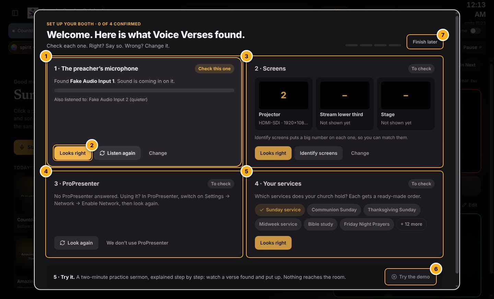

1. **The preacher’s microphone.** Voice Verses listens to every input and picks the one with sound. Ask someone to speak into the pulpit microphone; the bar moves.
2. Press **Looks right** if it found the right one. Press **Listen again** to look again, or **Change** to pick the input and the desk channel yourself (for example the channel called APOSTLE).
3. **Screens.** Each output (projector, stream lower third, stage) shows the number of the screen it goes to. Press **Identify screens** to put a big number on every screen in the room, then **Looks right**.
4. **ProPresenter.** If you use it, Voice Verses finds it on this computer or the network: press **Yes, that’s it**. This only remembers where it is; it does not start sending anything. If you don’t use ProPresenter, press **We don’t use ProPresenter**.
5. **Your services.** Tick the services your church holds (Sunday service, Midweek, Friday Night Prayers…). Each one gets a ready-made order of service. Press **Looks right**.
6. **Try the demo** plays a two-minute practice sermon, explained step by step. Nothing reaches the room.
7. **Finish later** closes it. You can open it again any time from Settings → Booth check → **Set up your booth**.

### All four confirmed

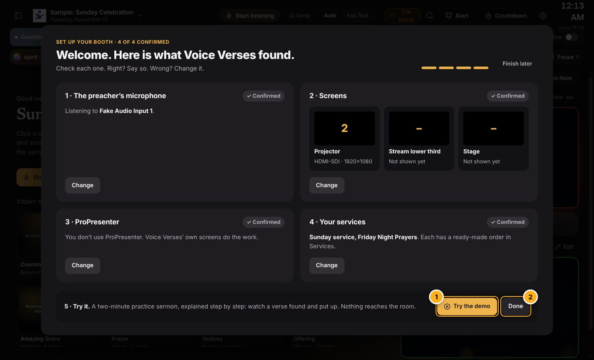

1. **Try the demo** to see Voice Verses at work.
2. **Done** takes you to the live screen.

## 2. The live screen at a glance

Everything for the service happens on this one screen. It is the same every Sunday.

### The live screen

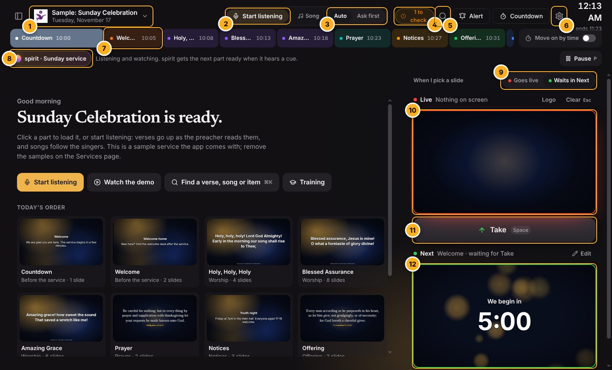

1. **The service.** Click its name for the other pages (Plan services, Media, Looks, Screens, Training, Settings).
2. **Start listening.** Voice Verses starts hearing the preacher. While it listens, a level meter moves and **Mute** stops it hearing for a moment.
3. **Auto / Ask first.** *Auto*: a verse the preacher says outright goes straight up. *Ask first*: it waits in Next until you press Take.
4. **Booth check.** *Ready* (grey tick) or *n to check* (amber). Click it to see what needs a look.
5. **Search** (⌘K on a Mac, Ctrl+K on Windows): a verse, a song, a part of the service or an action.
6. **Settings** (the gear).
7. **The order of service.** Each part is as wide as its time. Click a part to load it.
8. **spirit** shows what it will get ready next. **Pause** (or the P key) stops it doing anything by itself.
9. **When I pick a slide:** *Goes live* shows it at once; *Waits in Next* (the usual choice) puts it in Next first.
10. **Live** (red): what the room sees now.
11. **Take** (Space bar): puts Next on the screens.
12. **Next** (green): what goes up when you press Take.

### Before anything is on the screens

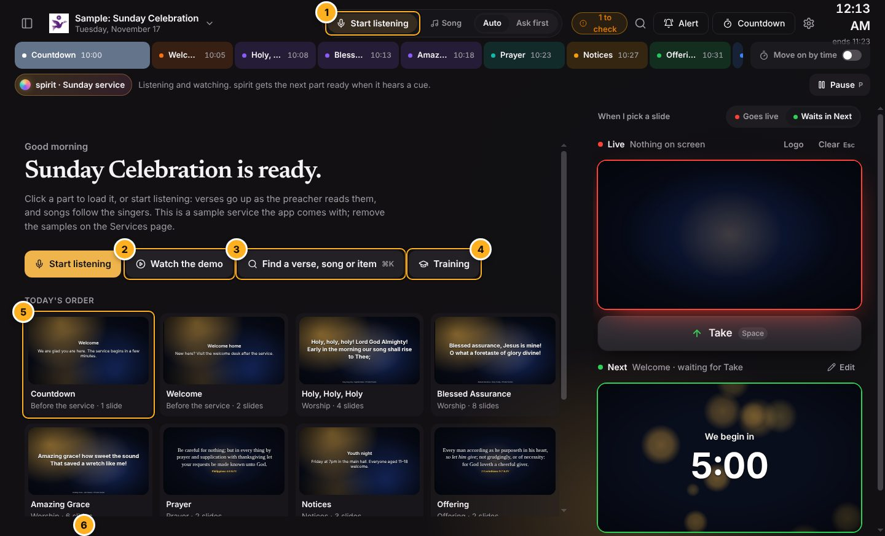

1. **Start listening** when the service begins.
2. **Watch the demo**: a two-minute sermon and hymn, explained aloud with a pointer.
3. **Find a verse, song or item** opens Search.
4. **Training**: short lessons on these real screens.
5. **Today’s order**: click any part to load its slides.
6. **Show a verse**: quick buttons for well-known verses.

## 3. Watch the demo

The demo plays a short sermon and a hymn through the real listening engine. A voice says what is happening, and a pointer shows where.

### The demo explains each step

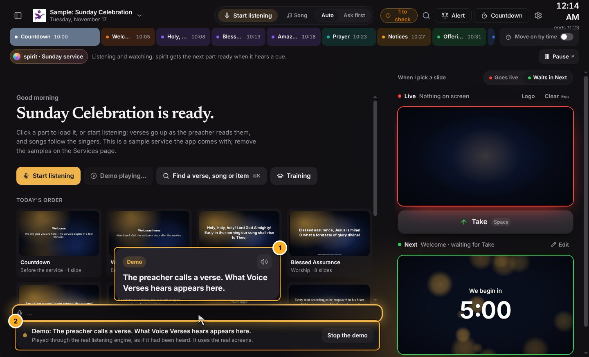

1. **The card** says what is happening; the same words are spoken. The speaker button turns the voice off.
2. **Stop the demo** ends it at any time.

### Following the reading

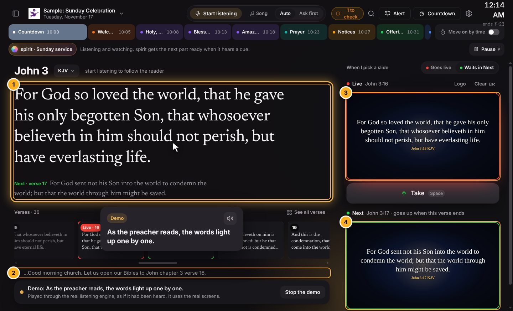

1. **The verse being read**, large, with the word being read underlined.
2. **Heard**: the last words Voice Verses heard.
3. **Live**: the verse went up because the preacher said “John chapter 3 verse 16”.
4. **Next**: the following verse is ready, in case the preacher reads on. It goes up when this verse ends.

## 4. Put a verse on the screens yourself

Three steps: find it, check it in Next, press Take.

### Search

1. Press **⌘K** (Ctrl+K on Windows), or click the magnifying glass. Type the verse: *John 3:16*, *Psalm 23*, *Romans 8:28-39*.
2. Press **Return**, or click **Show John 3:16**.

### The verse waits in Next

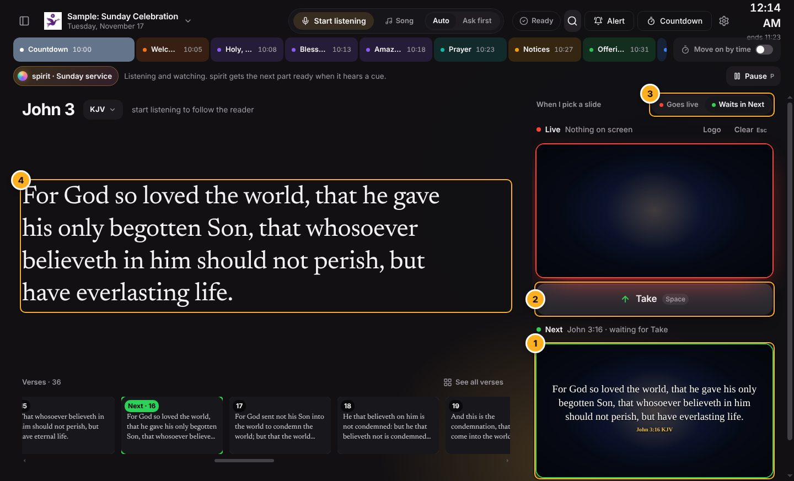

1. **Next** shows exactly how it will look on the projector.
2. Press **Take** (or the Space bar) to put it on the screens.
3. **When I pick a slide** decides whether picking goes straight to the screens (*Goes live*) or waits in Next (*Waits in Next*).
4. The verse also shows large here, with the rest of the chapter underneath to pick from.

### On the screens

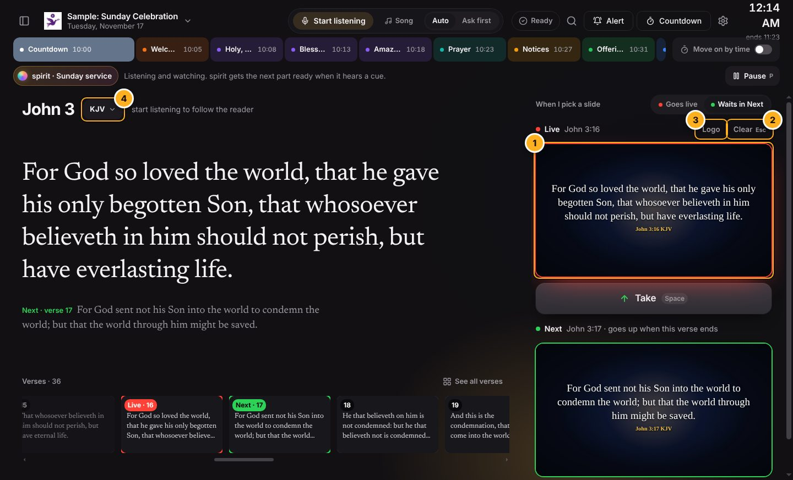

1. **Live** (red) now shows John 3:16, and so does the room.
2. **Clear** (Esc) takes the words off the screens.
3. **Logo** shows the church logo on every screen.
4. **KJV ▾** changes the translation of everything on screen and in Next.

**Good to know**

- Press **→** for the next verse and **←** for the one before.

## 5. Let it listen

Press Start listening and the preacher does the work.

### A suggestion

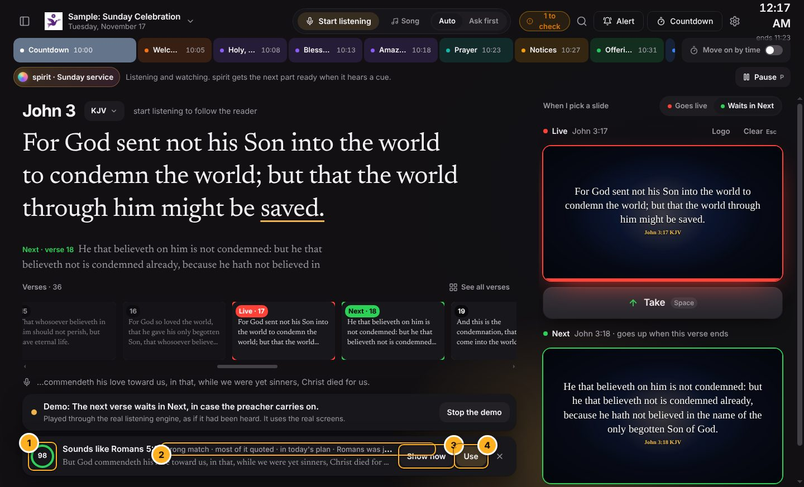

1. **The ring** shows how much of the verse’s wording was heard.
2. **Why** it was suggested, in plain words (most of it quoted, in today’s plan, the book was mentioned…).
3. **Show now** puts it straight on the screens.
4. **Use** puts it in Next, to check first. The × dismisses it. Click the bar to see every suggestion of the last few minutes.

**Good to know**

- **Said outright** (“John 3:16”, “John chapter 3 verse 16”, “Romans 8 from verse 28”): in *Auto* it goes straight up; in *Ask first* it waits in Next.
- **Read aloud**: each verse goes up as the reader gets to it, and the next one waits in Next.
- **Named without a verse** (“turn to Isaiah 53”): the chapter loads and waits until the preacher reads or names a verse.
- **Quoted or told in their own words**: offered as a **suggestion**. It never goes up by itself unless it is word for word (99% sure).
- **During songs**, press **♪ Song** so verses stay off the screen unless a reference is said outright.

## 6. Songs and slides

Songs, announcements and pictures come from the order of service.

### Load a part of the service

1. Click the part in the **order of service** (here, the hymn *Holy, Holy, Holy*).
2. Its **slides** appear along the bottom. Click one to pick it; double-click to show it at once.
3. The first slide waits in **Next**.
4. Press **Take** (Space) to show it, then Space again for each slide.
5. **See all slides** shows them as a grid.

### A song on the screens

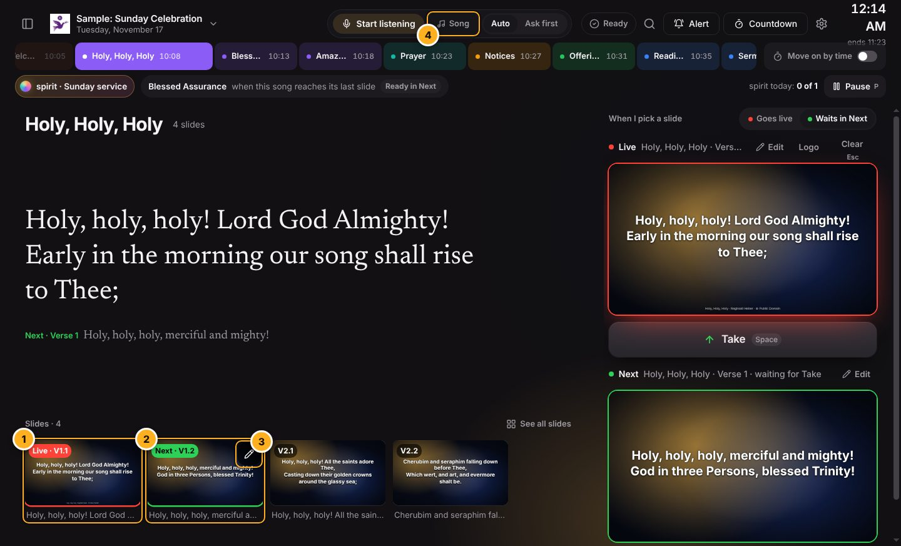

1. **Live · V1.1**: the slide on the screens, framed red.
2. **Next · V1.2**: the slide that comes next, framed green.
3. **The pencil** (Quick edit) fixes a word or changes the look, even during the service.
4. **♪ Song**: while the church sings, the words follow the singers, and verses stay off the screen.

### Quick edit

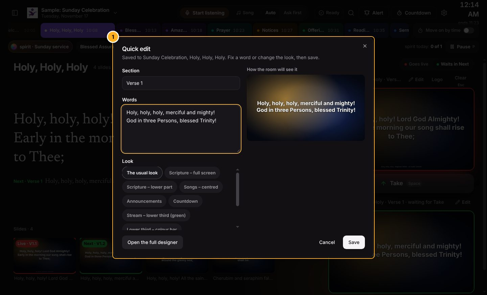

1. Change the section name, the words or the **look**, and see how the room will see it. Press **Save**. For the full designer, press **Open the full designer**.

### Every slide as a grid

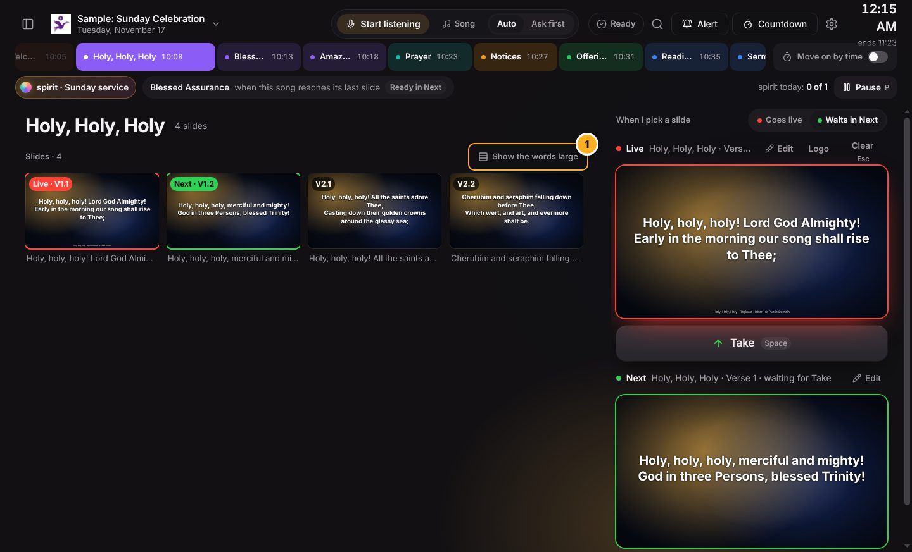

1. **Show the words large** goes back to the normal view.

**Good to know**

- The worship leader can call parts of the song out loud: “Verse two!”, “Back to the chorus”. Voice Verses goes there.
- New words that are in no song are offered as a new song, and kept as a draft afterwards.

## 7. Countdowns and alerts

Both buttons are at the top of the live screen and every other page.

### Countdown

1. **Quick start**: before the service, until the service starts, a sermon timer (stage only), and more.
2. **Length of time** (5 minutes) or **Until a time** (10:00).
3. **Message** above the numbers, such as “Service begins in”.
4. **Show it on**: all screens, the projector, the stage monitor or the stream; full screen or small in the corner.
5. **Turn yellow with** 1 minute left; **Blink** when yellow and red. It turns red at zero, and the stage shows how far over it is.
6. **Start**. Several countdowns can run at once, each on its own screens.

### Alert: a message over whatever is on screen

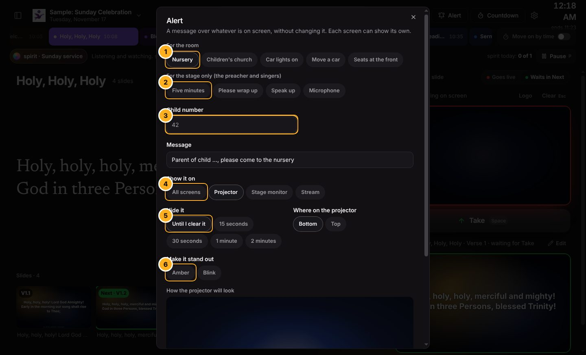

1. **For the room**: nursery, children’s church, car lights, move a car, seats at the front.
2. **For the stage only**: five minutes, please wrap up, speak up, microphone.
3. Type the **child number** or number plate (or write any message).
4. **Show it on**: which screens.
5. **Hide it**: until you clear it, or after 15 seconds to 2 minutes.
6. **Amber** and **Blink** make it stand out. The preview shows how the projector will look; the button under it shows the alert. While one is up, the Alert button turns amber with an × to clear it.

## 8. Is everything ready?

The booth check looks at the microphone, the screens, ProPresenter, the Bible and today’s service every minute.

### The booth check light

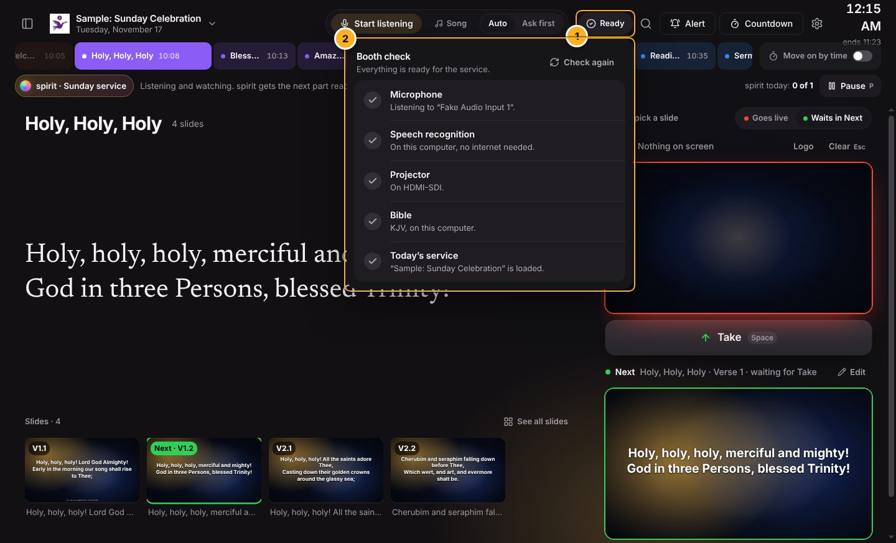

1. **Ready** (grey tick) or **n to check** (amber). Click it.
2. Each check, with a button that takes you straight to the fix.

### Settings → Booth check

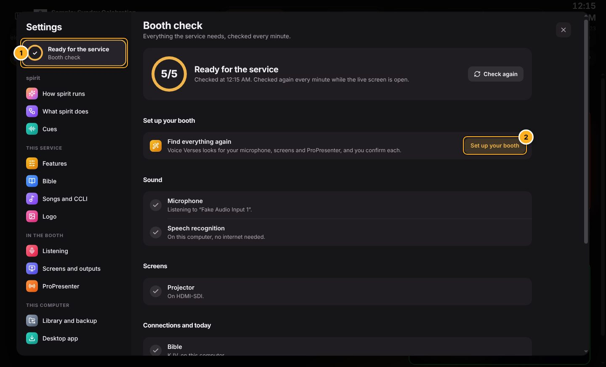

1. The **booth check** at the top of Settings.
2. **Set up your booth** finds everything again.

**Good to know**

- During the service, a problem (a screen unplugged, no sound for 20 seconds) shows as an amber warning under the top bar, with its fix button.

## 9. Settings, page by page

Open Settings with the gear. Everything saves as you change it; there is no Save button to forget.

### Features: what Voice Verses does by itself

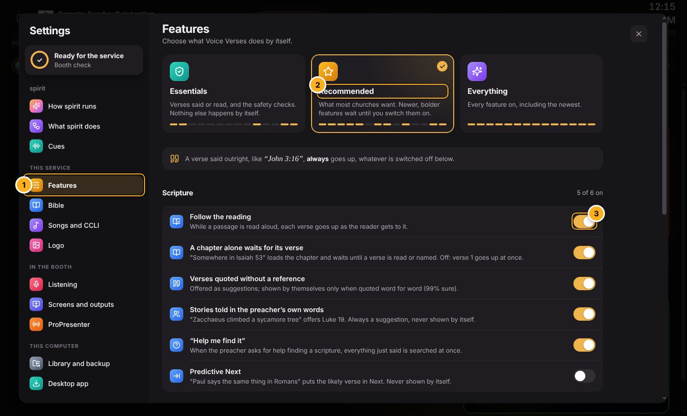

1. **Features** in the sidebar.
2. Choose **Essentials**, **Recommended** or **Everything**.
3. Or switch each feature on or off. A verse said outright always goes up, whatever is off.

### Listening: the microphone

1. **Listening** in the sidebar.
2. **Input**: the microphone or the sound desk’s USB feed.
3. **Sound check**: speak and the bar moves. If the desk sends many channels, click the preacher’s channel (its meter moves when they speak).

### Screens and outputs

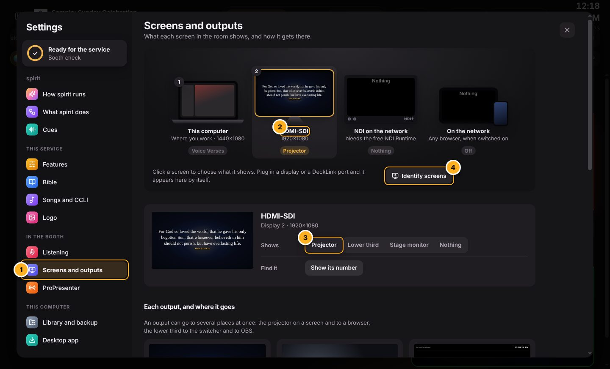

1. **Screens and outputs** in the sidebar.
2. **Click a screen** in the picture of the room.
3. Choose what it **shows**: Projector, Lower third, Stage monitor or Nothing. It opens there by itself, every time.
4. **Identify screens** puts a big number on every screen.

### ProPresenter (optional)

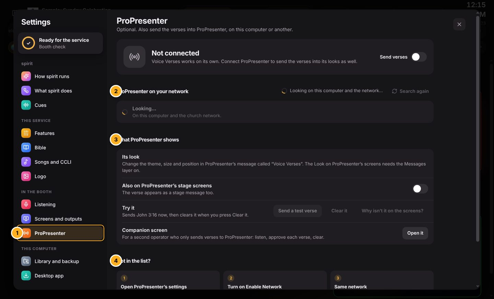

1. **ProPresenter** in the sidebar.
2. **ProPresenter on your network**: press **Connect** beside yours. The **Send verses** switch at the top turns sending on or off.
3. **What ProPresenter shows**: its look, also on its stage screens, **Send a test verse**, **Clear it** and **Why isn’t it on the screens?**
4. **Not in the list?** Three steps to switch on ProPresenter’s network setting, or type its address yourself.

### Bible translations

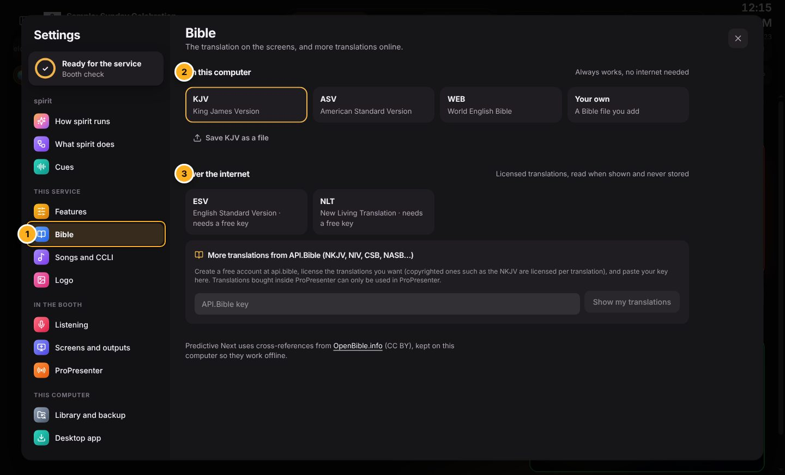

1. **Bible** in the sidebar.
2. **On this computer**: KJV, ASV, WEB, or your own. Always works, no internet needed.
3. **Over the internet**: ESV, NLT and API.Bible translations (NKJV, NIV, CSB…), each with a free key from its publisher.

### Songs and CCLI

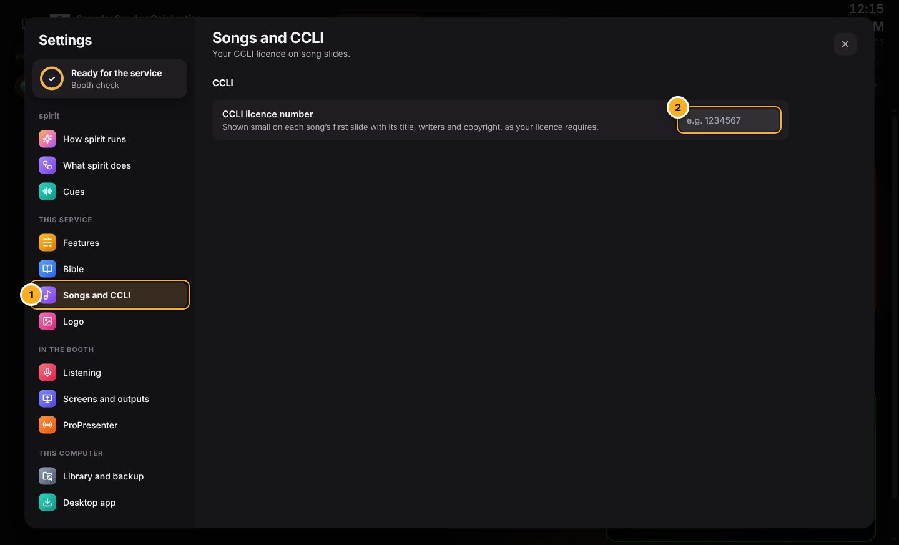

1. **Songs and CCLI** in the sidebar.
2. Your **CCLI licence number**, shown small on each song’s first slide with its writers and copyright.

### Logo

1. **Logo** in the sidebar. **Choose a picture**; a transparent PNG looks best. The Logo button shows it on every screen.

### Library and backup

1. **Library and backup** in the sidebar. **Choose folder** inside iCloud Drive, Dropbox, OneDrive or Google Drive to back up your services and share them between computers.

## 10. spirit: let it run the service

spirit learns how your church runs its service, gets the next thing ready, and earns your trust one move at a time. It never puts a verse up that wasn’t said.

### How spirit runs

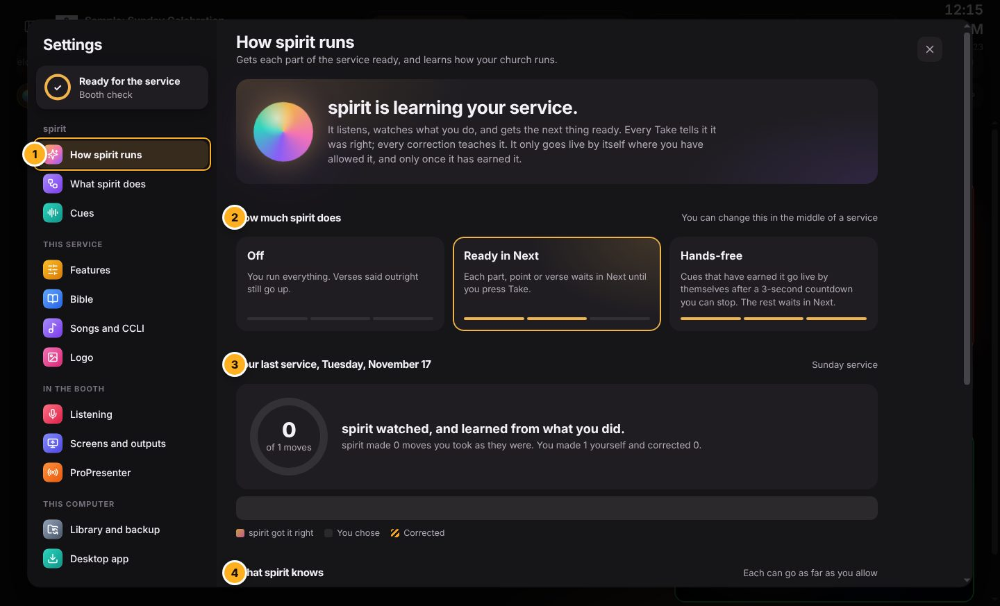

1. **How spirit runs** in the sidebar.
2. **How much spirit does**: *Off*; *Ready in Next* (it gets things ready and you press Take); *Hands-free* (only for moves that have been right 10 times in a row).
3. **Your last service**: what spirit got right, what you chose, what you corrected.
4. **What spirit knows**.

### What spirit does

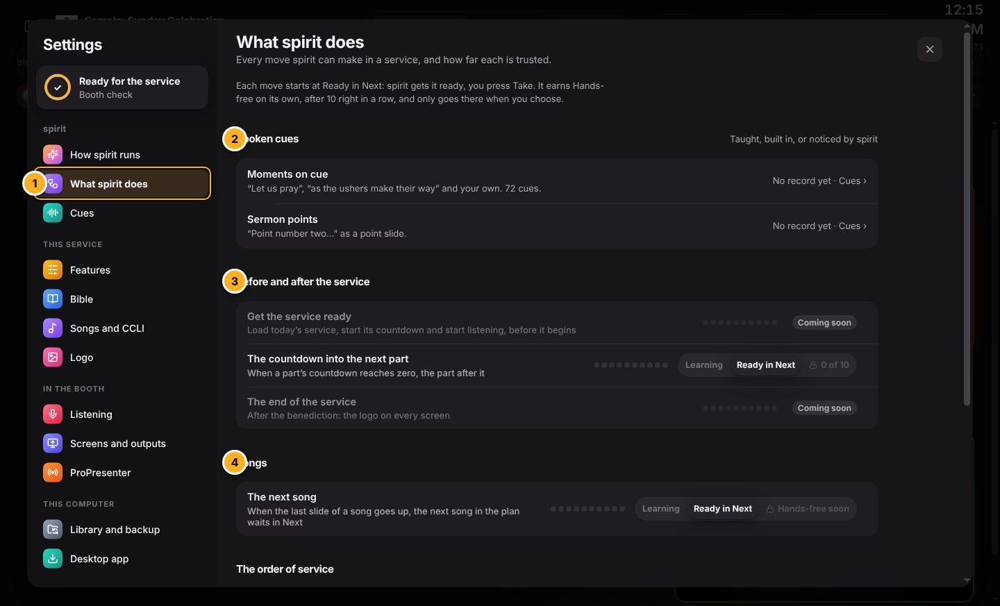

1. **What spirit does** in the sidebar.
2. **Spoken cues**: moments and sermon points.
3. **Before and after the service**: the countdown into the next part, and more coming soon.
4. **Songs**: the next song when one ends.

### Cues: teach spirit your church’s words

1. **Cues** in the sidebar. At the top, fill in the sentence: *When the preacher says* “as the ushers make their way” *get* Offering *ready*, then press **Teach spirit**.
2. **Prayer**: the phrases spirit already knows for prayer (“let us pray”, “bow your heads”…).
3. **Giving**: “tithes and offerings”, “receive the offering”…
4. **Welcome**, and below it every other moment of the service, each with its phrases.

**Good to know**

- spirit also learns by watching: when the same words keep coming before the same part, it suggests them as a new cue.
- If spirit gets something wrong, press **Not this** beside Next and say why (wrong part, not now, never for these words). It remembers.
- **Pause** (P) on the live screen hands everything back to you at once.
- When listening stops, **How it went** shows spirit’s score, with **Just this once** to undo a correction.

## 11. Plan your services

Open **Services** from the page bar (or the service name on the live screen).

### Services

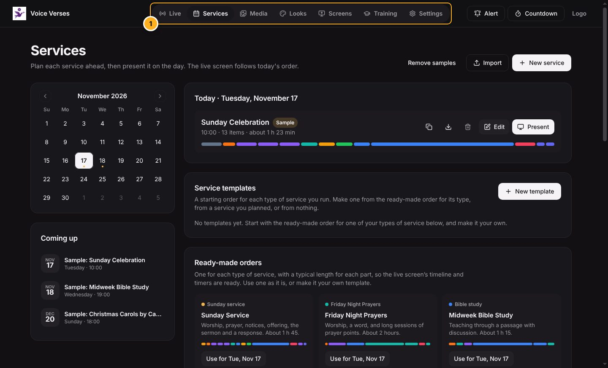

1. The **page bar**: Live, Services, Media, Looks, Screens, Training, Settings. Pick a day in the calendar; its services show with **Edit** and **Present**. **New service** is at the top right.

### Templates and ready-made orders

1. **New template**: your own order of service for a type of service, from a ready-made order, a service you have, or nothing.
2. **Ready-made orders**: one for every type of service. **Use for** the chosen day, or **Make it a template**.

### The service editor

1. **Type of service** (Sunday service, Communion Sunday, Friday Night Prayers…). spirit learns each type separately.
2. **Save as a template** keeps this service as a starting point for next time.

**Good to know**

- Add parts with the tiles on the left: **Scripture**, **Song**, **Announcement**, **Picture**, **Video**, **Countdown**. Drag to reorder.
- **Copy for next Sunday** (on the Services page) makes a fresh copy of a service.
- **Present** opens the service as a list of slides, with Live and Next beside it.

## 12. Media, Looks, Screens and Presenter

### Media

Pictures, videos and songs. **Add files** takes pictures, videos and SongSelect song files (.usr or .txt) with their writers, copyright and CCLI number. Songs here are recognised when the church sings them.

### Looks

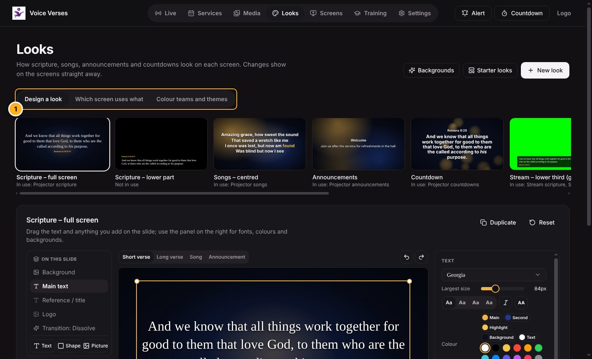

1. Three tabs: **Design a look** (the designer), **Which screen uses what**, and **Colour teams and themes**. **Backgrounds** has moving backgrounds and 40 samples; **Starter looks** has ready-made designs.

### Screens

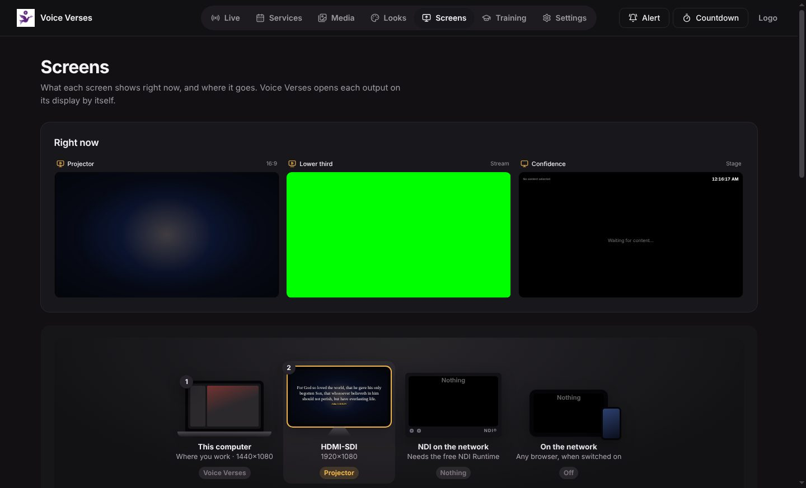

**Right now**: what each screen shows. Below it, the same settings as Settings → Screens and outputs.

### Presenter

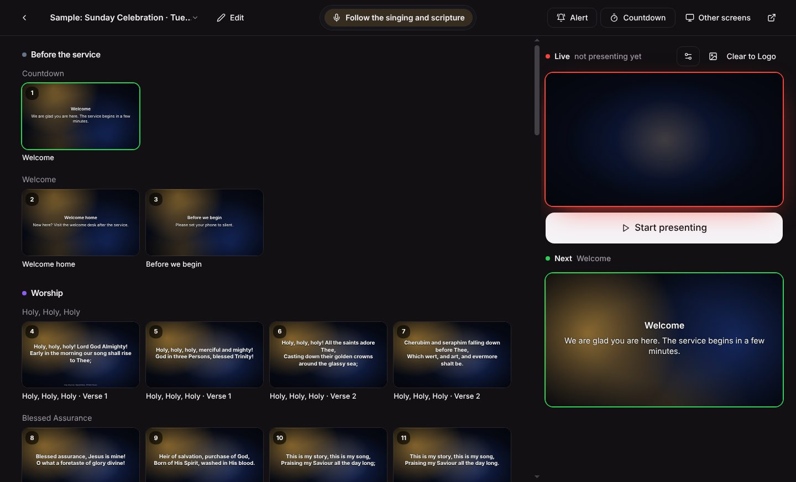

Every slide of the service by section. Click one to show it; **Start presenting** and **Clear to Logo** at the top.

## 13. Training

Short lessons on the real screens, in practice: nothing reaches the projector, the stream, the stage or ProPresenter.

### Training

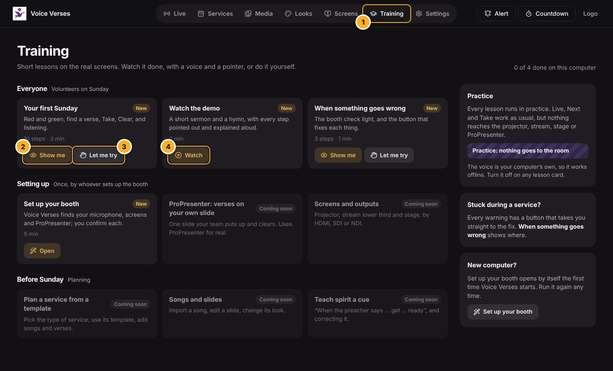

1. **Training** in the page bar (or the Training button on the live screen).
2. **Show me**: Voice Verses does each step, with a pointer and a voice.
3. **Let me try**: you do each step; it waits and checks.
4. **Watch**: the demo, explained aloud.

### Show me

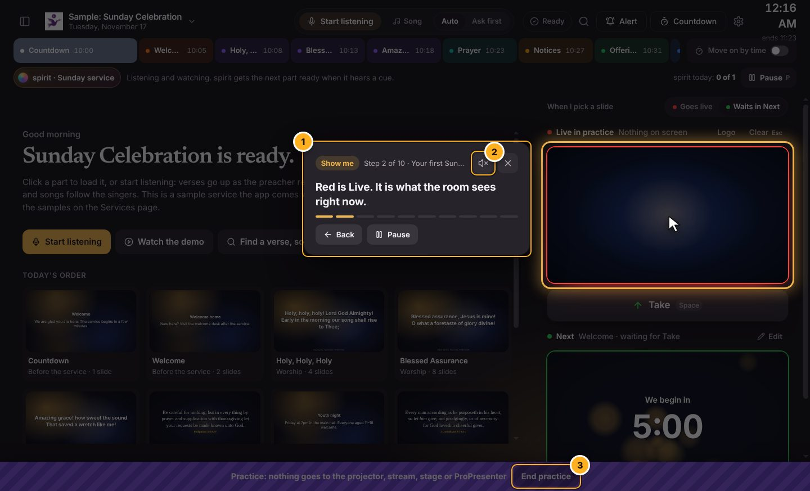

1. **The step**, on a card beside the control. **Back**, **Pause**, and **Let me try this step**.
2. **The speaker** turns the voice on or off. The × (or Esc) leaves the lesson.
3. **End practice** on the violet band stops the lesson.

### Let me try

1. **The lit control** is the one to click.
2. Click somewhere else and it says what you clicked, and nothing changes. After two tries it offers **Show me this step**.

## 14. What the room sees

### The projector

Scripture, songs and slides in their look, with countdowns and alerts on top.

### The stage monitor

The current verse or slide, what is coming next, the clock and any stage countdown or alert.

### The stream lower third

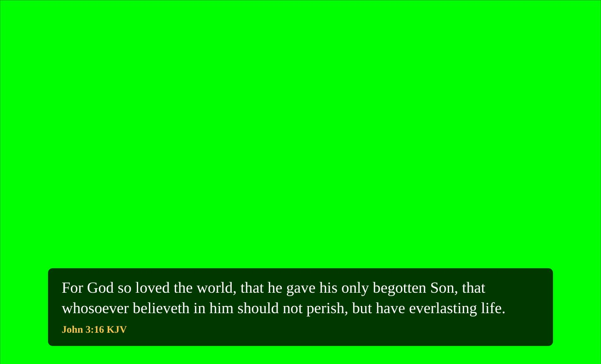

The verse on a green key colour for the stream switcher. Over NDI it goes see-through.

## Keyboard

| Key | What it does |
| --- | --- |
| Space or Return | Take: put Next on the screens |
| Esc | Clear the words off the screens |
| → and ← | Next or previous verse or slide |
| ⌘K (Mac), Ctrl+K (Windows) | Search |
| P | Pause or resume spirit |
| Double-click a slide | Show it now |

## When something goes wrong

| If… | Do this |
| --- | --- |
| Nothing happens when the preacher speaks | Look at the booth check light. In Settings → Listening, check the input and speak: the bar must move. With a desk feed, click the preacher’s channel. |
| A screen is black or on the wrong display | Settings → Screens and outputs → Identify screens, then click the screen and choose what it shows. |
| A wrong verse was suggested | Press × on the suggestion. Suggestions never go up by themselves. Switch to Ask first if you want every verse to wait in Next. |
| spirit got the wrong part ready | Press Not this beside Next and say why. Press P to pause spirit. |
| ProPresenter’s message covers its screens | In ProPresenter, Hide the “Voice Verses” message; Voice Verses stops sending until you choose Send again. To stop for good: Settings → ProPresenter → Send verses off. |
| Something went up by mistake | Press Esc to clear, or the Logo button. |
| You want to practise | Training → Your first Sunday → Let me try. Nothing reaches the room. |

---

The pictures are made by `tools/guide/capture.cjs` from the real app with its sample service; the words are in `tools/guide/content.py`. Run both again when the app changes.
